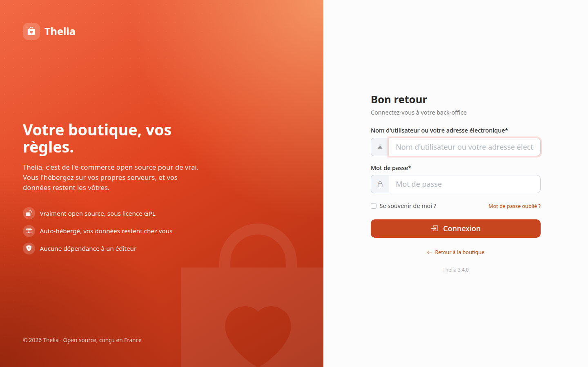
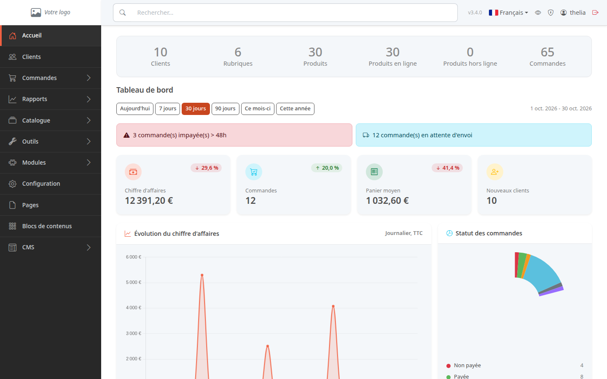
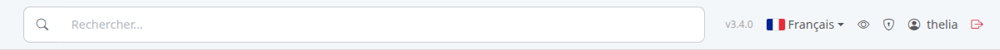

Le back-office est l'espace d'administration de votre boutique. C'est là que vous gérez les produits, les commandes et les clients. Ce tutoriel vous montre comment y entrer et comment lire la première page.

**Avant de commencer :** il vous faut l'adresse de votre boutique et un compte administrateur (identifiant et mot de passe).

## Étape 1 : se connecter

1. Dans votre navigateur, tapez l'adresse de votre boutique suivie de `/admin`, par exemple `https://www.ma-boutique.fr/admin`.
2. Dans **Nom d'utilisateur ou votre adresse électronique**, saisissez votre identifiant.
3. Dans **Mot de passe**, saisissez votre mot de passe.
4. Cliquez sur **Connexion**.

Mot de passe perdu : cliquez sur **Mot de passe oublié ?** sous le champ.

## Étape 2 : lire le tableau de bord

Après la connexion, vous arrivez sur le tableau de bord. Il résume l'activité de la boutique.

De haut en bas :

- **Les compteurs** : nombre de clients, de rubriques, de produits (en ligne et hors ligne) et de commandes.
- **La période** : les boutons **Aujourd'hui**, **7 jours**, **30 jours**, **90 jours**, **Ce mois-ci** et **Cette année** changent la période des chiffres en dessous.
- **Les alertes** : par exemple les commandes impayées depuis plus de 48 heures ou en attente d'envoi. Cliquez sur une alerte pour ouvrir la liste des commandes concernées. Une alerte n'apparaît que s'il y a quelque chose à traiter.
- **Les indicateurs** : chiffre d'affaires, commandes, panier moyen et nouveaux clients. Le pourcentage compare la période choisie à la période précédente de même durée.
- **Les graphiques** : l'évolution du chiffre d'affaires jour par jour et la répartition des commandes par statut.

Plus bas, faites défiler la page pour voir les **Commandes récentes**, les **Meilleures ventes** et le **Stock faible** (les 5 stocks les plus bas parmi ceux à 5 unités ou moins, une ligne par variante de produit).

## Étape 3 : se repérer dans le menu

Le menu à gauche donne accès à chaque partie de la boutique : **Clients**, **Commandes**, **Catalogue**, **Configuration**, etc. Une flèche à droite d'une entrée signale un sous-menu.

La barre du haut contient les outils disponibles sur toutes les pages :

- le champ **Rechercher...** pour retrouver un produit, une rubrique, une marque, un contenu, un client ou une commande ;
- la version de Thelia installée, à indiquer quand vous demandez de l'aide ;
- la **langue de l'interface** : cliquez sur le drapeau pour passer le back-office dans une autre langue ;
- l'œil : **Voir le site**, ouvre votre boutique dans un nouvel onglet ;
- le bouclier : **Sécurité du compte** ;
- votre identifiant : **Modifier le profil** ;
- l'icône rouge : **Se déconnecter**.

## Le résultat

Vous savez entrer dans le back-office et lire l'activité de la boutique en un coup d'œil. Pensez à vous déconnecter sur un ordinateur partagé.
