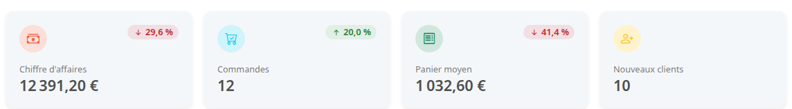
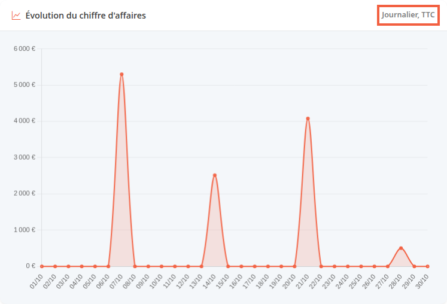
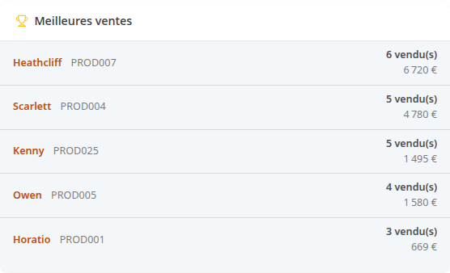
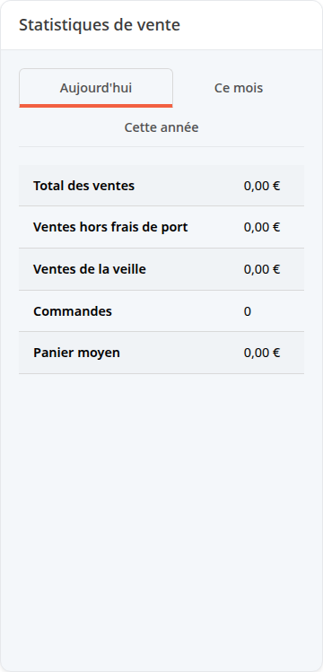
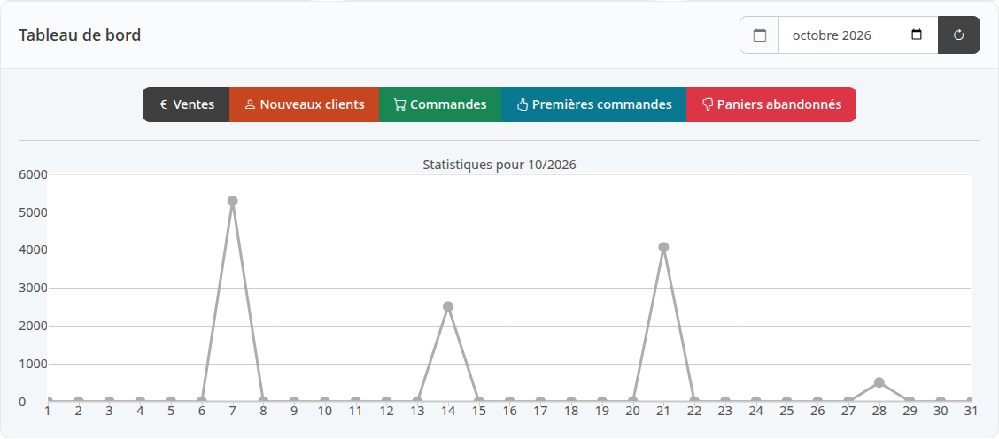

Le tableau de bord affiche plusieurs familles de chiffres qui ne comptent pas toutes les mêmes commandes ni sur la même période. Cette page dit, pour chaque chiffre, ce qu'il compte, pour que vous sachiez le lire sans vous tromper. Elle suppose que vous avez lu [Découvrir le back-office](/getting-started/back-office-tour/), qui présente l'écran et les boutons de période.

**Avant de commencer :** il vous faut un compte administrateur qui a accès aux commandes. Sans ce droit, les chiffres de vente, les graphiques et les listes de commandes n'apparaissent pas.

## Les commandes « payées » : ce que compte le chiffre d'affaires

Dans cette page, une commande payée est une commande au statut **Payée**, **Traitement** ou **Envoyée**. Un statut déclaré équivalent à l'un de ces trois compte aussi, comme **Partiellement expédiée**, livré avec Thelia et équivalent à **Payée**. Les commandes **Non payée**, **Annulée** et **Remboursé** n'entrent pas dans les montants de vente.

## Étape 1 : choisir la période

Au chargement, la période est **30 jours**. Les boutons changent la période des quatre cartes, du graphique **Évolution du chiffre d'affaires** et de la liste **Meilleures ventes** :

- **Aujourd'hui** : de minuit à 23 h 59 aujourd'hui.
- **7 jours** : aujourd'hui et les 6 jours précédents.
- **30 jours** : aujourd'hui et les 29 jours précédents.
- **90 jours** : aujourd'hui et les 89 jours précédents.
- **Ce mois-ci** : du 1er du mois à aujourd'hui.
- **Cette année** : du 1er janvier à aujourd'hui.

Les dates exactes s'affichent à droite des boutons.

## Étape 2 : lire les quatre cartes

- **Chiffre d'affaires** : total des commandes payées passées pendant la période. Il est toutes taxes comprises, frais de port inclus, remises déduites.
- **Commandes** : nombre de commandes passées pendant la période, tous statuts confondus. Les commandes non payées et annulées sont comptées.
- **Panier moyen** : **Chiffre d'affaires** divisé par **Commandes**. Comme les commandes non payées et annulées sont au dénominateur, il peut être plus bas que le montant moyen d'une commande payée.
- **Nouveaux clients** : comptes clients créés pendant la période.

Le pourcentage en haut de chaque carte compare la période à la période précédente de même durée, juste avant. Pour **30 jours**, ce sont les 30 jours d'avant.

Il n'apparaît pas si la période précédente est à zéro et que la période actuelle est supérieure à zéro. Sous 0,5 % d'écart, la flèche est remplacée par un tiret.

Cliquer sur **Chiffre d'affaires** ou **Commandes** ouvre la liste complète des commandes, sans filtre de période, et **Nouveaux clients** la liste des clients. **Panier moyen** n'est pas cliquable.

## Étape 3 : lire les graphiques

- **Évolution du chiffre d'affaires** : un point par jour de la période. Chaque point est le chiffre d'affaires de la carte, calculé pour ce jour avec les mêmes commandes payées. Le sous-titre de l'écran est **Journalier, TTC**.
- **Statut des commandes** : nombre de commandes par statut, sur toute la vie de la boutique. Ce bloc ne suit pas les boutons de période. Un statut sans commande n'est pas listé.

## Étape 4 : lire les listes

- **Commandes récentes** : les 8 dernières commandes passées, tous statuts, quelle que soit la période.
- **Meilleures ventes** : les 5 produits les plus vendus pendant la période, classés par quantité. La ligne **vendu(s)** donne le nombre d'unités ; le montant dessous est le prix des lignes de commande, hors taxes, au prix promo si le produit était en promotion, sans déduire la remise de la commande, affiché sans les centimes. Toutes les commandes comptent, même non payées ou annulées.
- **Stock faible (≤ 5)** : une combinaison est une variante vendable d'un produit, par exemple une taille ou une couleur. La liste montre jusqu'à 5 combinaisons, tous produits confondus, dont le stock est de 5 unités ou moins, les plus basses d'abord, quelle que soit la période. Chaque ligne porte le nom du produit, la référence de la combinaison et son stock. Un produit hors ligne y figure aussi.

## Étape 5 : lire le bloc Statistiques de vente

Plus bas, le bloc **Statistiques de vente** ne suit pas les boutons de période. Il a trois onglets : **Aujourd'hui**, **Ce mois** (le mois en cours) et **Cette année** (l'année en cours).

- **Total des ventes** : commandes payées, toutes taxes comprises, frais de port inclus, remises déduites. Elles sont rattachées à leur date de facture, c'est-à-dire le jour où la commande est passée en payée, pas à leur date de création.
- **Ventes hors frais de port** : la même somme sans les frais de port.
- **Ventes de la veille** (onglet **Aujourd'hui**), **Ventes du mois précédent**, **Ventes de l'année précédente** : le **Total des ventes** de la période d'avant.
- **Commandes** : commandes payées créées pendant la période.
- **Panier moyen** : **Ventes hors frais de port** divisées par **Commandes**.

Les montants de ce bloc et la carte **Chiffre d'affaires** utilisent les mêmes statuts, mais pas la même date : création de la commande pour la carte, date de facture pour le bloc. Une commande passée le 31 octobre et payée le 1er novembre compte donc en octobre sur la carte et en novembre dans le bloc.

## Étape 6 : lire le graphique du mois

Tout en bas, la carte **Tableau de bord** trace un mois à la fois, jour par jour. Choisissez le mois dans le champ à côté du calendrier : le graphique se met à jour. Les chiffres sont gardés 10 minutes. Le bouton d'actualisation ne les recalcule qu'au deuxième clic : le premier affiche encore les anciens chiffres.

Changer de mois remplace aussi les chiffres de l'onglet **Ce mois** du bloc **Statistiques de vente** par ceux du mois choisi.

Chaque bouton affiche ou masque sa courbe. Au chargement, seule **Ventes** est affichée.

- **Ventes** : le total des ventes du jour, calculé comme **Total des ventes** (commandes payées, date de facture).
- **Nouveaux clients** : comptes créés ce jour-là.
- **Commandes** : commandes dont la date de facture tombe ce jour-là, quel que soit leur statut actuel. Une commande jamais payée n'a pas de date de facture : elle n'est pas comptée.
- **Premières commandes** : commandes passées ce jour-là par un client qui n'avait encore jamais commandé.
- **Paniers abandonnés** : commandes dont le statut est le numéro 5 et dont la date de facture tombe ce jour-là. Dans une installation de base, c'est le statut **Annulée**. La courbe compte donc les commandes annulées après avoir été payées, pas les visiteurs qui n'ont pas commandé : une commande annulée sans avoir été payée n'y figure pas.

## Le résultat

Vous savez quelle commande entre dans quel chiffre : les montants de vente ne comptent que les commandes payées, alors que la carte **Commandes** et **Meilleures ventes** comptent aussi les autres. En cas d'écart entre deux blocs, comparez d'abord la période et la date utilisées.
