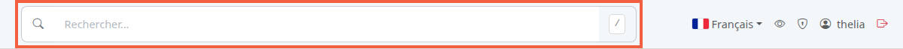
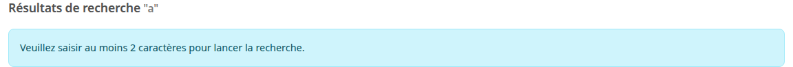
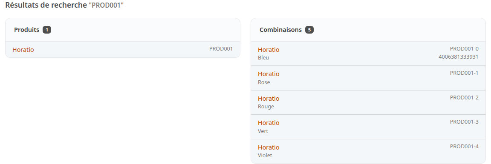

La barre de recherche du back-office cherche dans tout le catalogue, les clients, les commandes et les réglages à la fois. Elle vous évite de naviguer de menu en menu pour retrouver une fiche.

Exemple : saisir `PROD001` pour ouvrir le produit de cette référence, ou le nom d'un client pour retrouver sa fiche.

**Avant de commencer :** rien de particulier. Vous ne voyez que ce que votre profil a le droit de consulter.

## Étape 1 : saisir un terme

1. Cliquez dans le champ **Rechercher...** en haut de n'importe quel écran. Sans la souris, appuyez sur la touche **/** : le curseur y va. La touche ne fait rien si vous êtes déjà en train de saisir dans un champ.
2. Saisissez au moins 2 caractères, par exemple `PROD001`.
3. Validez avec la touche Entrée.

Avec un seul caractère, la page affiche **Veuillez saisir au moins 2 caractères pour lancer la recherche.**

## Étape 2 : lire les résultats

Les résultats se présentent par groupe. Un groupe n'apparaît que s'il contient un résultat.

| Groupe | La recherche porte sur |
|---|---|
| Produits | la référence, la référence ou le code-barres d'une combinaison, le titre |
| Combinaisons | la référence, le code-barres (GTIN) |
| Catégories, dossiers, contenus, marques, promotions | le titre |
| Clients | la référence, le prénom, le nom, le nom complet, l'e-mail, le téléphone |
| Commandes | la référence, la référence de facture, la référence de transaction |
| Codes promo | le code, le titre |
| Administrateurs | l'identifiant, le nom, l'e-mail |
| Modules | le code, le titre |

Une combinaison est une variante du produit, par exemple une couleur. Un produit trouvé par une combinaison affiche le nom de cette combinaison sous son titre.

## Étape 3 : comprendre l'ordre et les limites

- Dans chaque groupe, une référence ou un titre identique au terme passe en premier, puis ceux qui commencent par le terme, puis ceux qui le contiennent. Les meilleurs résultats sont donc en haut.
- Pour un produit ou une combinaison, saisissez la référence complète : la boutique la trouve tout de suite, même avec un grand catalogue.
- Un code-barres se trouve s'il est saisi en entier. Les espaces et les tirets sont acceptés : `4006381333931`, `4 006381 333931` ou `4006381-333931`. Une partie du code ne trouve rien.
- Les symboles `%` et `_` se cherchent tels quels.
- Les titres s'affichent dans la langue de votre interface. S'il manque dans cette langue, la boutique prend la langue par défaut, puis une autre. La recherche porte sur les titres de toutes les langues.
- Un groupe affiche 25 résultats au plus. S'il y en a davantage, son titre indique par exemple **25 sur 30**. Pour les produits, les clients et les commandes, le lien **Ouvrir la liste filtrée sur ce terme** ouvre la liste complète. Pour les autres groupes, **Voir les 30 résultats** les affiche page par page.
- Les commandes se limitent aux points de vente de l'administrateur.

## Ce qui dépend de votre profil

Un groupe n'est cherché que si votre profil peut consulter la ressource correspondante. Un profil limité au catalogue ne voit ni clients, ni commandes, ni codes promo, ni administrateurs.

Au-delà de 120 recherches en une minute, la page répond **Trop de recherches à la suite. Réessayez dans une minute.**

Si le module TntSearch est actif, la page de recherche de ce module remplace celle du back-office.

## Le résultat

La page **Résultats de recherche** liste les groupes qui correspondent. Cliquez sur un titre pour ouvrir la fiche.
