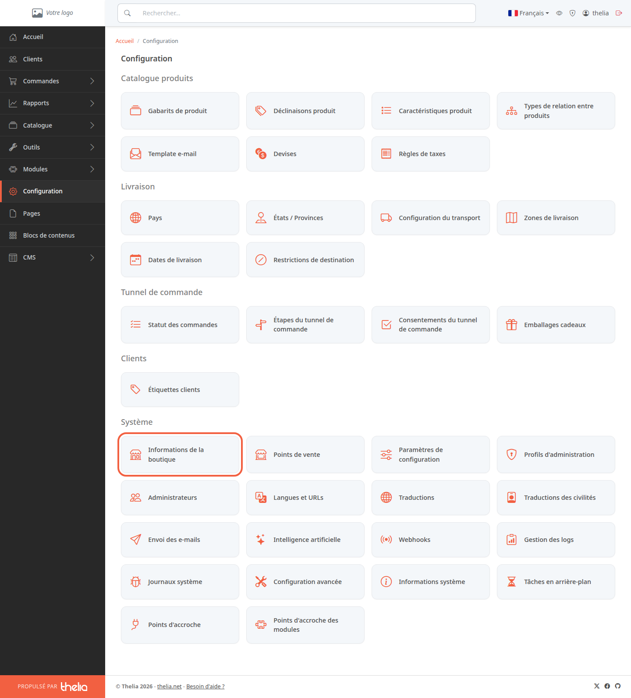
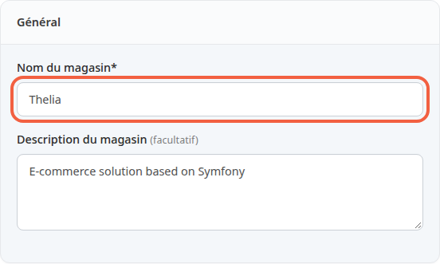
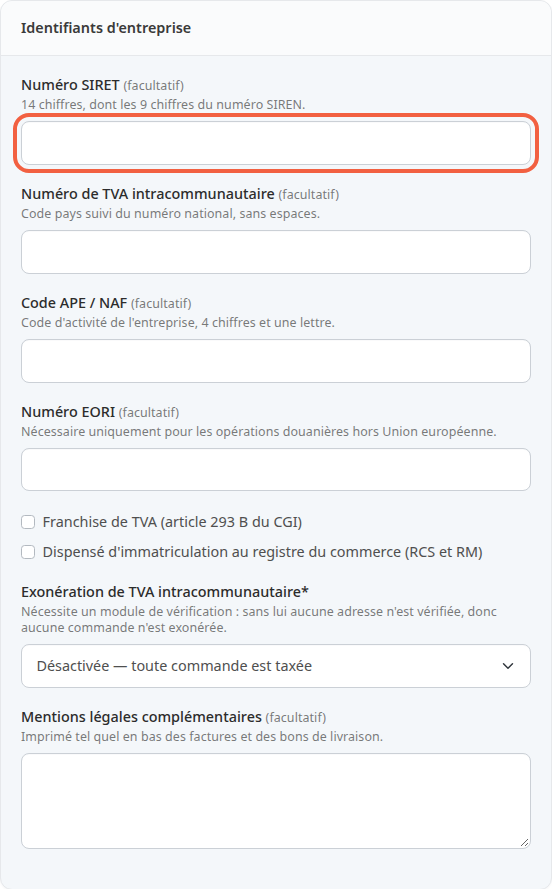
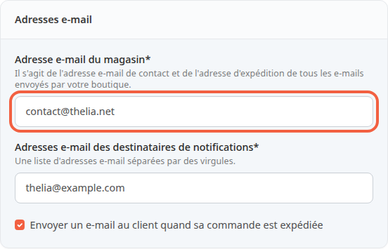
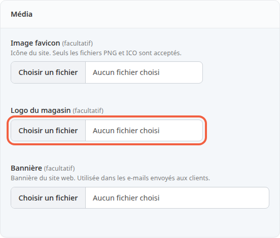
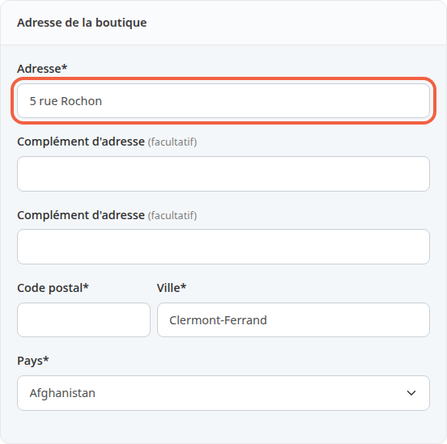

Cet écran regroupe l'identité de votre boutique : son nom, son adresse, ses adresses e-mail et son logo. Ces informations servent dans les e-mails envoyés à vos clients et sur vos documents : remplissez-les en premier.

**Avant de commencer :** il vous faut un compte administrateur (voir [Découvrir le back-office](/getting-started/back-office-tour/)) et, sous la main, l'adresse postale de votre boutique.

## Étape 1 : ouvrir l'écran

1. Dans le menu de gauche, cliquez sur **Configuration**.
2. Dans le bloc **Système**, cliquez sur **Informations de la boutique**.

L'écran s'appelle **Configuration de la boutique**. Il est découpé en blocs. Les champs suivis d'une étoile sont obligatoires.

## Étape 2 : donner le nom de la boutique

1. Dans **Nom du magasin**, saisissez le nom de votre boutique, par exemple `Atelier du Bois`.
2. Dans **Description du magasin**, vous pouvez ajouter une phrase de présentation, par exemple `Meubles en bois fabriqués à la main`. Ce champ est facultatif.

## Étape 3 : renseigner les identifiants d'entreprise

Ce bloc est facultatif. Les numéros servent à identifier votre société, par exemple sur les documents de vente.

1. Dans **Numéro SIRET**, saisissez les 14 chiffres de votre numéro. Les espaces et les points sont acceptés.
2. Dans **Numéro de TVA intracommunautaire**, saisissez le code du pays suivi du numéro, sans espaces, par exemple `FR12345678901`. La TVA est la taxe ajoutée au prix de vente.
3. Dans **Code APE / NAF**, saisissez 4 chiffres et une lettre, par exemple `4759A`.
4. Cochez **Franchise de TVA (article 293 B du CGI)** seulement si votre entreprise ne facture pas la TVA. La case imprime la mention de franchise sur les factures. Laissez alors **Numéro de TVA intracommunautaire** vide : les deux ensemble sont refusés.
5. Dans **Mentions légales complémentaires**, ajoutez au besoin un texte (500 caractères au plus). Il est imprimé tel quel en bas des factures et des bons de livraison.

La case de franchise ne retire pas la TVA des prix : celle-ci vient des règles de taxes (voir [Régler la TVA](/settings/tax-rules/)).

Les autres champs du bloc (**Numéro EORI**, **Dispensé d'immatriculation au registre du commerce (RCS et RM)**, **Exonération de TVA intracommunautaire**) peuvent rester tels quels.

Un numéro au mauvais format, ou un SIRET dont la clé de contrôle est fausse, est refusé à l'enregistrement, avec un message sous le champ.

## Étape 4 : saisir les adresses e-mail

1. Dans **Adresse e-mail du magasin**, saisissez l'adresse de contact de la boutique, par exemple `contact@atelier-du-bois.fr`. C'est aussi l'adresse d'expédition de tous les e-mails envoyés par la boutique : vos clients la voient comme expéditeur. Les messages du formulaire de contact de la boutique arrivent à cette adresse.
2. Dans **Adresses e-mail des destinataires de notifications**, saisissez les adresses qui reçoivent les alertes de la boutique, par exemple `commandes@atelier-du-bois.fr`. Pour plusieurs adresses, séparez-les par des virgules.
3. Laissez cochée **Envoyer un e-mail au client quand sa commande est expédiée** si vous voulez que Thelia prévienne vos clients de l'expédition. Décochez-la si vous les prévenez autrement. Un module de livraison peut envoyer son propre e-mail, que cette case ne commande pas.

Les destinataires de notifications reçoivent le message qui annonce chaque nouvelle commande. Un champ vide est refusé : saisissez au moins une adresse.

## Étape 5 : ajouter le logo

1. Dans **Logo du magasin**, cliquez sur **Choisir un fichier** et choisissez votre logo (PNG, JPEG, GIF, WebP ou SVG). Il s'affiche en haut des e-mails envoyés aux clients.
2. Dans **Bannière**, choisissez une image large. Elle s'affiche dans le corps de l'e-mail de confirmation de commande et de celui de confirmation d'inscription à la newsletter, pas dans les autres e-mails.

Ces deux champs sont facultatifs. Une fois le fichier choisi, un aperçu de l'image s'affiche à côté du champ, ou dessous pour la bannière.

Laissez **Image favicon** vide : avec le thème de boutique livré par défaut, l'icône de l'onglet du navigateur vient des fichiers du thème, pas de ce champ.

## Étape 6 : saisir l'adresse et le téléphone

1. Dans **Adresse**, saisissez la rue, par exemple `12 rue des Tilleuls`.
2. Dans **Complément d'adresse**, ajoutez au besoin un bâtiment ou un étage. Il y a deux lignes, toutes deux facultatives.
3. Dans **Code postal**, saisissez par exemple `63000`, puis dans **Ville**, `Clermont-Ferrand`.
4. Dans **Pays**, choisissez le pays de la boutique dans la liste. Tant qu'aucun pays n'a été enregistré, la liste affiche le premier par ordre alphabétique, par exemple Afghanistan : vérifiez-le avant d'enregistrer.
5. Dans le bloc **Téléphone & Fax**, saisissez votre numéro dans **Téléphone**. **Fax** est facultatif.

## Étape 7 : enregistrer

- Cliquez sur **Enregistrer** pour garder les valeurs et rester sur l'écran.
- Cliquez sur **Enregistrer et fermer** pour revenir à la page **Configuration**.
- Cliquez sur **Annuler** pour quitter sans enregistrer.

Plus bas, l'écran contient d'autres blocs (tunnel de commande, administrateurs, cache des pages publiques, vidéos). Ils ne concernent pas ce tutoriel.

## Le résultat

Après l'enregistrement, les valeurs restent affichées quand vous rouvrez **Informations de la boutique**. Vos clients reçoivent désormais les e-mails depuis l'adresse du magasin et vous recevez les notifications de commande.
