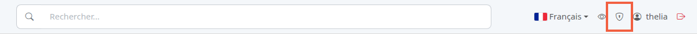
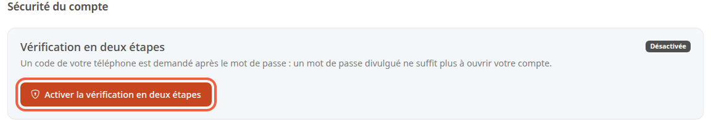
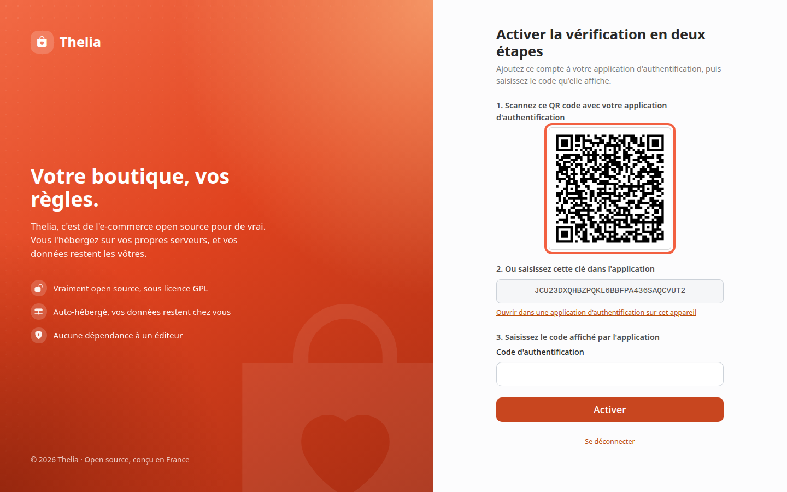
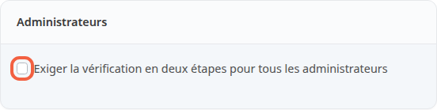

La double authentification ajoute un code temporaire à votre mot de passe quand vous vous connectez au back-office. Si votre mot de passe fuit, une autre personne ne peut pas ouvrir votre compte sans ce code.

Le code vient d'une application d'authentification : une application gratuite de votre téléphone qui affiche un nombre à 6 chiffres, renouvelé toutes les 30 secondes.

**Avant de commencer :** il vous faut un compte administrateur et une application d'authentification installée sur votre téléphone.

## Étape 1 : ouvrir la sécurité du compte

1. Dans la barre du haut, cliquez sur le bouclier.

La page **Sécurité du compte** s'ouvre. Le bloc **Vérification en deux étapes** indique **Désactivée** tant que vous n'avez rien activé.

2. Cliquez sur **Activer la vérification en deux étapes**.

## Étape 2 : ajouter votre compte dans l'application

L'écran **Activer la vérification en deux étapes** montre un QR code et une clé.

1. Ouvrez votre application d'authentification sur le téléphone.
2. Choisissez d'ajouter un compte.
3. Scannez le QR code sous **1. Scannez ce QR code avec votre application d'authentification**.

Le QR code ne passe pas ? Sous **2. Ou saisissez cette clé dans l'application**, recopiez dans l'application la clé affichée dans le champ gris. Sur le téléphone qui ouvre cette page, le lien **Ouvrir dans une application d'authentification sur cet appareil** fait la même chose.

## Étape 3 : saisir le code et conserver les codes de secours

1. Lisez le nombre à 6 chiffres affiché par l'application pour votre compte.
2. Saisissez-le dans **Code d'authentification**, sous **3. Saisissez le code affiché par l'application**.
3. Cliquez sur **Activer**.

Un code qui ne correspond pas est refusé, avec le message « Ce code ne correspond pas. Vérifiez l'heure de votre appareil et réessayez. » Les codes dépendent de l'heure : vérifiez que l'heure du téléphone est réglée automatiquement.

Une fois le code accepté, la page **Conservez vos codes de secours** affiche 10 codes de 10 caractères. Chacun vous connecte une seule fois si vous n'avez pas votre téléphone.

1. Cliquez sur **Copier les codes**, ou notez-les.
2. Rangez-les ailleurs que sur votre téléphone : ils ne seront plus affichés.
3. Cliquez sur **Continuer**.

Si vous perdez à la fois votre téléphone et vos codes de secours, vous ne pouvez plus vous connecter.

Un autre administrateur qui a le droit de modifier les administrateurs doit alors choisir **Réinitialiser la vérification en deux étapes** sur votre compte, dans la liste des administrateurs. Seul un superadministrateur peut le faire pour un autre superadministrateur. À défaut, la personne qui gère le serveur de la boutique peut la réinitialiser.

## Étape 4 : vous connecter ensuite

À chaque connexion, après le mot de passe, l'écran **Vérification en deux étapes** demande un code.

1. Saisissez le code de l'application dans **Code d'authentification**.
2. Cliquez sur **Vérifier**.

Sans téléphone : cliquez sur **Utiliser un code de secours** et saisissez l'un de vos codes. Les espaces et les tirets saisis sont ignorés. Un code de secours utilisé ne sert plus.

Un code refusé affiche « Identifiants invalides. ». Au cinquième code refusé, ou 5 minutes après le mot de passe, vous revenez à l'écran de connexion.

## Gérer la protection ensuite

Sur **Sécurité du compte**, une fois la protection activée, la page indique **Activée** et le nombre de codes de secours restants.

- **Générer de nouveaux codes de secours** crée dix nouveaux codes. Les précédents ne fonctionnent plus.
- Pour retirer la protection, saisissez votre mot de passe dans **Votre mot de passe**, puis cliquez sur **Désactiver**.

## Quand la protection est obligatoire

Un administrateur peut exiger la protection pour tous les comptes : dans **Configuration**, **Informations de la boutique**, la case **Exiger la vérification en deux étapes pour tous les administrateurs** se trouve dans le bloc **Administrateurs**. Cochez-la, puis cliquez sur **Enregistrer**.

Activez d'abord la protection sur votre propre compte : sinon, vous êtes envoyé vers l'écran d'activation dès la page suivante.

Quand elle est cochée, un administrateur sans protection est envoyé vers l'écran d'activation dès sa connexion. L'écran affiche alors « Cette boutique exige la vérification en deux étapes pour tous les administrateurs. »

## Le résultat

La page **Sécurité du compte** affiche **Activée**, et chaque connexion demande votre mot de passe puis un code.
