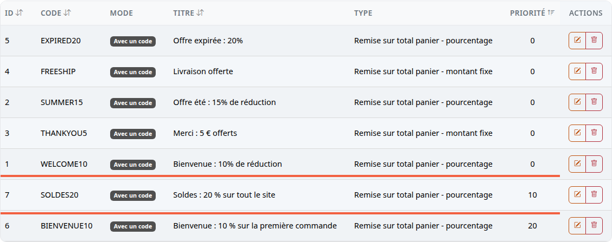
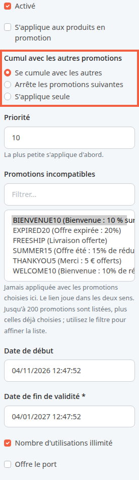
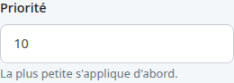
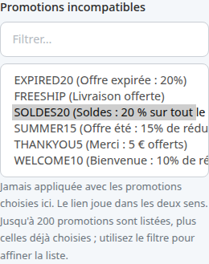
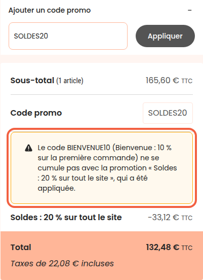

Votre boutique propose un code de bienvenue, BIENVENUE10 (10 % sur la première commande), et lance ses soldes avec SOLDES20 (20 % sur tout le site). Vous ne voulez pas qu'un acheteur additionne les deux. Cette page montre comment régler l'ordre des promotions, leur cumul et leurs incompatibilités pour que la boutique choisisse seule, quel que soit l'ordre dans lequel l'acheteur tape ses codes.

**Avant de commencer :** il vous faut un compte administrateur et les codes promo à régler, déjà créés.

## Les trois réglages en bref

Chaque code promo (et chaque promotion automatique, qui s'applique sans code) porte trois réglages :

- **Priorité** : un nombre entier, 0 par défaut. La boutique examine les promotions de la plus petite priorité à la plus grande. À priorité égale, les promotions automatiques passent avant les codes, puis la plus ancienne avant la plus récente.
- **Cumul avec les autres promotions** : la promotion se cumule, arrête celles qui suivent, ou s'applique seule.
- **Promotions incompatibles** : la liste des promotions avec lesquelles elle ne s'applique jamais.

Une promotion mise de côté ne consomme pas son utilisation : si le code est limité à 100 utilisations, une commande où il a été écarté ne compte pas.

## Étape 1 : voir l'ordre des promotions

1. Dans le menu à gauche, cliquez sur **Outils**.
2. Cliquez sur **Codes promo**.
3. Cliquez sur l'en-tête de la colonne **Priorité** pour trier la liste dans l'ordre où la boutique examine les promotions.

Ici, SOLDES20 (priorité 10) passe avant BIENVENUE10 (priorité 20). Les codes de la démo restent à 0.

La colonne **Cumul** n'apparaît pas sur la capture : faites défiler le tableau vers la droite pour la voir. Elle indique **S'applique seule**, **Arrête les promotions suivantes** ou le nombre de promotions incompatibles, par exemple **1 incompatible(s)** sur la ligne de SOLDES20. Elle reste vide pour une promotion qui se cumule sans incompatibilité.

## Étape 2 : choisir comment la promotion se cumule

1. Sur la ligne de SOLDES20, cliquez sur l'icône **Modifier** (le crayon).
2. Repérez le bloc **Cumul avec les autres promotions**.
3. Choisissez l'une des trois options.

- **Se cumule avec les autres** : la remise s'ajoute à celles des autres promotions retenues. Exemple : 20 % de soldes et la livraison offerte par un autre code.
- **Arrête les promotions suivantes** : la promotion s'applique, avec celles retenues avant elle, et toutes celles qui viennent après dans l'ordre sont mises de côté.
- **S'applique seule** : elle ne se combine avec aucune autre. Si une promotion est déjà retenue avant elle, c'est elle qui est mise de côté. Sinon, elle s'applique et les suivantes sont mises de côté.

Un code enregistré avant cette version s'ouvre sur **Se cumule avec les autres** s'il était cumulable, sur **S'applique seule** sinon.

## Étape 3 : régler la priorité

1. Dans le champ **Priorité**, saisissez un nombre entier. Exemple pour SOLDES20 : 10.
2. Cliquez sur **Enregistrer**.

Laissez des écarts entre vos priorités (10, 20, 30) : vous pourrez glisser une nouvelle promotion entre deux sans tout renuméroter. Un nombre négatif est accepté et passe avant 0.

## Étape 4 : déclarer les promotions incompatibles

1. Toujours sur la fiche de SOLDES20, repérez la liste **Promotions incompatibles**.
2. Si la liste est longue, tapez quelques lettres du code dans **Filtrer…**, par exemple BIEN.
3. Cliquez sur BIENVENUE10 pour le sélectionner. Pour en choisir plusieurs, maintenez la touche Ctrl (Cmd sur Mac) en cliquant.
4. Cliquez sur **Enregistrer**.

Le lien joue dans les deux sens : rouvrez BIENVENUE10, SOLDES20 y est déjà sélectionné. Vous n'avez pas à le déclarer une seconde fois.

Pour retirer une incompatibilité, désélectionnez le code (Ctrl ou Cmd + clic) puis enregistrez. Le lien disparaît aussi de l'autre promotion.

## Ce que voit l'acheteur

Un acheteur ajoute un fauteuil à son panier, saisit BIENVENUE10, puis SOLDES20. SOLDES20 a la plus petite priorité : la boutique l'examine en premier et le retient. BIENVENUE10 lui est incompatible : il est mis de côté.

Dans le récapitulatif du panier :

- la ligne **Code promo** ne montre que le code appliqué, SOLDES20 ;
- un encadré explique : « Le code BIENVENUE10 (Bienvenue : 10 % sur la première commande) ne se cumule pas avec la promotion « Soldes : 20 % sur tout le site », qui a été appliquée. » ;
- la ligne de remise porte le titre de la promotion appliquée.

Le résultat est le même si l'acheteur tape SOLDES20 en premier. Une promotion automatique mise de côté n'est jamais nommée à l'acheteur : il ne l'a pas demandée.

## Si vous mettez à jour votre boutique sans rien régler

Toutes vos promotions existantes prennent la priorité 0 et aucune incompatibilité. Un panier sans code, ou avec un seul code, plus d'éventuelles promotions automatiques, garde la même remise qu'avant la mise à jour. Seul peut changer le panier qui contient plusieurs codes dont un non cumulable : la boutique examine désormais ces codes dans l'ordre de leur création, et non plus dans l'ordre où l'acheteur les a saisis.

## Le résultat

Dans la liste des codes promo, la colonne **Priorité** montre l'ordre d'examen et la colonne **Cumul** les règles de chaque promotion. Dans le panier, un acheteur qui saisit deux codes incompatibles voit la remise du code prioritaire et un message qui nomme le code écarté.
