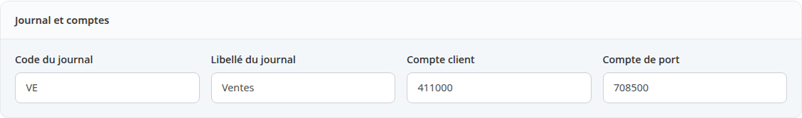
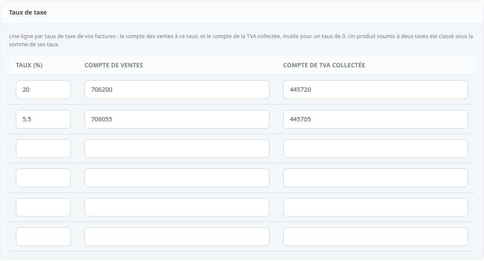
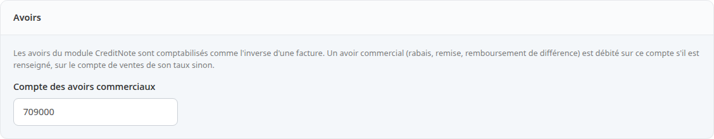
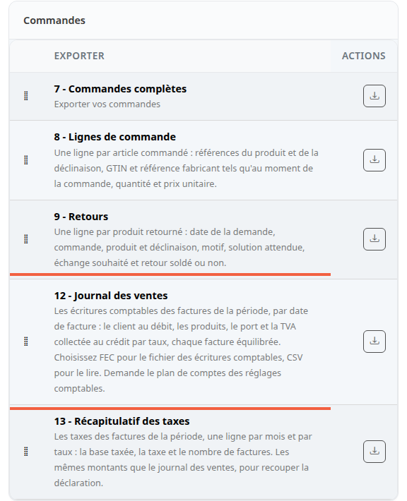
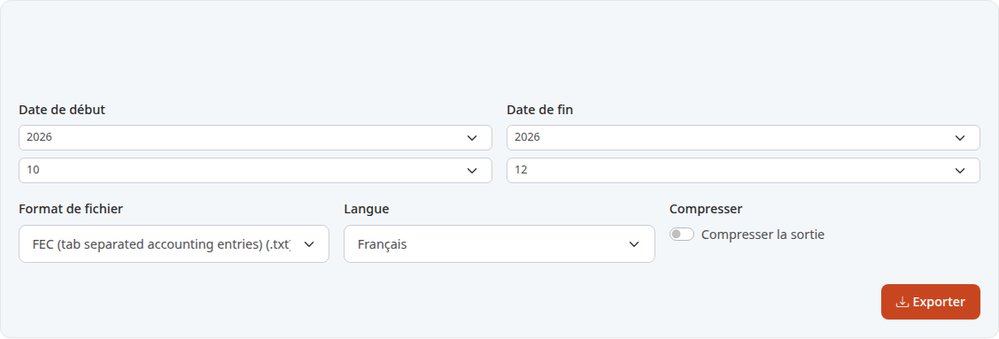

Le journal des ventes donne à votre comptable les factures d'une période sous la forme d'écritures comptables, dans un fichier que son logiciel sait charger. Vous évitez de retraiter à la main l'export des commandes.

**Avant de commencer :** vos commandes doivent être facturées (voir [Imprimer la facture et le bon de livraison](/orders/print-documents/)). Demandez à votre comptable les numéros de compte à utiliser.

## Étape 1 : renseigner le plan de comptes

Le plan de comptes dit sur quels comptes chaque montant est écrit. Il se renseigne une seule fois, avant le premier export. Tant qu'il est incomplet, le journal des ventes refuse de s'exécuter.

1. Dans le menu, cliquez sur **Configuration**.
2. Cliquez sur **Comptabilité**.

La page **Plan de comptes** s'ouvre. Tant qu'il manque des comptes, un bandeau l'indique : **Reste à renseigner : le compte client, le compte de port, les comptes des taux de taxe.**

## Étape 2 : saisir le journal et les comptes

Le premier bloc, **Journal et comptes**, a quatre champs.

1. **Code du journal** : le code du journal des ventes de votre comptabilité, par exemple `VE`.
2. **Libellé du journal** : son nom, par exemple `Ventes`. Laissés vides, ces deux champs valent `VE` et `Ventes`.
3. **Compte client** : le compte débité du total de chaque facture, par exemple `411000`.
4. **Compte de port** : le compte crédité du port, hors taxes, par exemple `708500`.

Un numéro de compte s'écrit avec des chiffres ou des lettres, 20 caractères au plus. Une autre valeur est refusée et rien n'est enregistré.

## Étape 3 : saisir un compte par taux de taxe

Le bloc **Taux de taxe** a une ligne par taux de TVA présent sur vos factures.

1. Dans **Taux (%)**, écrivez le taux, par exemple `20`.
2. Dans **Compte de ventes**, le compte des ventes à ce taux, par exemple `706200`.
3. Dans **Compte de TVA collectée**, le compte de la TVA correspondante, par exemple `445720`.
4. Ajoutez une ligne par autre taux, par exemple `5.5`.

Pour un taux de 0, le compte de TVA collectée reste vide. Un produit soumis à deux taxes est rangé sous la somme de ses taux : si vous en vendez, ajoutez une ligne pour cette somme.

## Étape 4 : les avoirs, si vous en faites

Le dernier bloc, **Avoirs**, ne sert qu'avec le module CreditNote. Les avoirs y sont écrits comme l'inverse d'une facture.

Un avoir commercial est une réduction accordée après la facture : rabais, remise, remboursement de différence. Si vous renseignez **Compte des avoirs commerciaux**, par exemple `709000`, il est débité sur ce compte. Sinon, il l'est sur le compte de ventes de son taux.

Cliquez sur **Enregistrer**. Le message **Le plan de comptes a été enregistré.** apparaît.

## Étape 5 : choisir le journal des ventes

1. Dans le menu, cliquez sur **Outils**, puis sur **Exporter**.
2. Dans la carte **Commandes**, repérez **12 - Journal des ventes**.
3. Cliquez sur le bouton de téléchargement de cette ligne.

La ligne juste dessous, **13 - Récapitulatif des taxes**, fait l'objet de la dernière section de cette page.

## Étape 6 : choisir la période et le format

1. Dans **Date de début**, choisissez l'année puis le mois du premier mois à exporter.
2. Dans **Date de fin**, choisissez l'année puis le mois du dernier. Ce mois est compris en entier.
3. Dans **Format de fichier**, choisissez le format voulu.
4. Cliquez sur **Exporter**.

Les factures sont rangées par date de facture : une commande passée en janvier et facturée en février est dans février.

Deux formats sont utiles :

- **FEC (tab separated accounting entries) (.txt)** : le fichier des écritures comptables que reçoit le logiciel du comptable (le libellé s'affiche en anglais). Il est séparé par des tabulations, avec une virgule décimale. Ne l'ouvrez pas dans un tableur, il est fait pour un logiciel de comptabilité.
- **CSV (.csv)** : à lire dans un tableur.

Si le plan de comptes est incomplet, l'export ne part pas et un message dit ce qui manque.

## Étape 7 : récupérer le fichier

Sur une boutique réglée comme à l'installation, le fichier se télécharge dès que vous cliquez sur **Exporter**. Il se nomme `sales_journal.txt` en FEC, `sales_journal.csv` en CSV.

Si votre boutique traite les exports en tâche de fond, une page **Exporter : Journal des ventes** s'ouvre à la place. Elle propose **Télécharger sales_journal.txt** et un bloc **Compte rendu de l'export** : le nombre de pièces, le total au débit et le total au crédit, qui doivent être égaux. Le cadre **À vérifier avant d'utiliser le fichier** liste ce que le journal n'a pas pu écrire.

Parmi ces points, des commandes de la période qui ont une date de facture mais pas de numéro de facture : elles ne sont pas dans le journal. Les commandes qui ne sont pas facturées sont comptées à part. Une commande qui ne peut pas être écrite, par exemple parce que son taux de TVA n'a pas de ligne dans le plan de comptes, est écartée et nommée.

Si vous remettez le fichier à votre comptable ou à l'administration, gardez-en une copie : la boutique supprime le fichier quand il a un jour.

## Récapitulatif des taxes

Pour recouper une déclaration de TVA, refaites l'étape 5 avec **13 - Récapitulatif des taxes**. Il donne une ligne par mois et par taux : la base taxée, la taxe et le nombre de pièces. Il est lu dans les mêmes pièces que le journal des ventes, ses montants de taxe en sont donc la somme exacte. Le format FEC ne lui est pas proposé : choisissez CSV.

## Le résultat

Vous avez un fichier de la période pour votre comptable.
