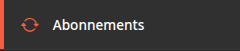
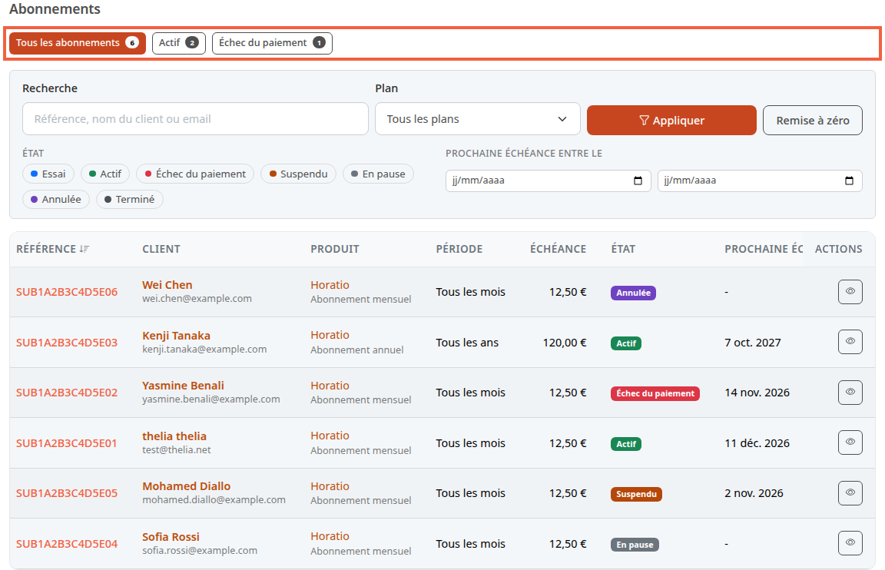
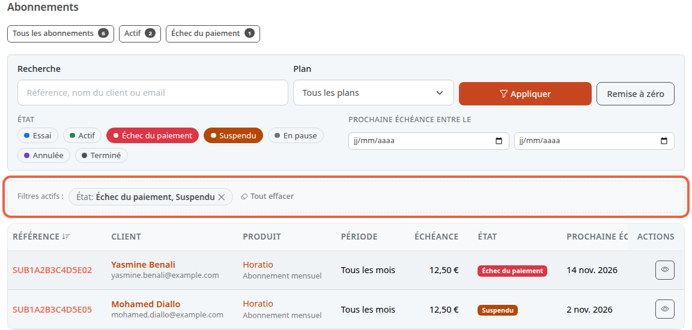
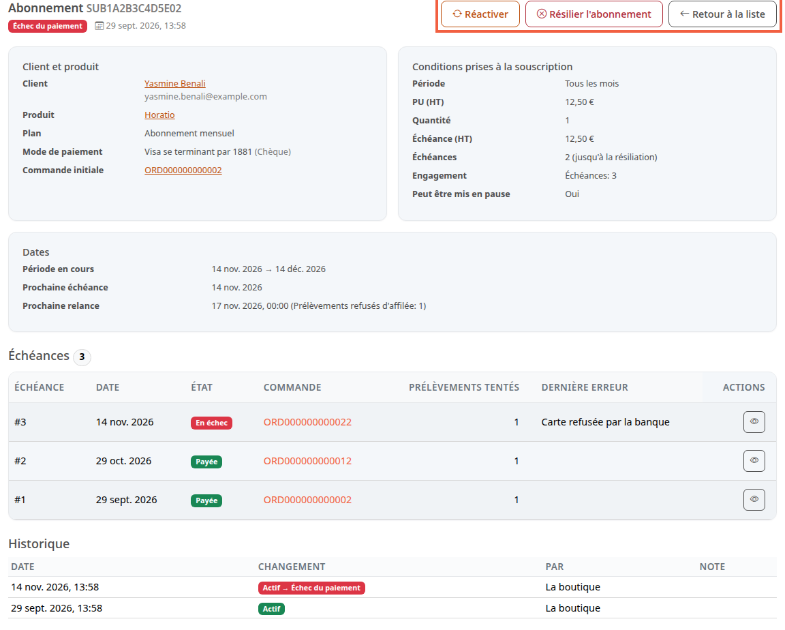
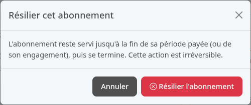

Chaque abonnement pris par un client a sa fiche : état, prochaine échéance, commandes déjà facturées, historique. Elle vous permet d'agir quand un prélèvement échoue ou quand un client le demande.

**Avant de commencer :** des plans existent sur un produit (voir [Vendre un produit par abonnement](/catalog/sell-by-subscription/)) et au moins un client s'est abonné. Votre profil doit avoir le droit **Abonnements** (code `admin.subscription` dans la liste des ressources d'un profil). Ce droit s'accorde profil par profil : un profil existant ne l'a pas tant qu'on ne le lui donne pas.

## Comment la boutique prélève

Chaque échéance est une commande ordinaire, avec sa référence, sa facture et son e-mail. La boutique la place et la prélève toute seule à la date prévue, sur le moyen de paiement que le client a enregistré.

Si un prélèvement est refusé, la boutique réessaie au bout de 2 jours, jusqu'à 3 prélèvements refusés. Ensuite l'abonnement passe en **Suspendu** et plus rien n'est prélevé tant que personne n'agit. Un développeur peut modifier ces deux valeurs.

## Étape 1 : ouvrir la liste

1. Dans le menu de gauche, cliquez sur **Abonnements**.

La liste donne pour chaque abonnement la référence, le client, le produit et le plan, la période, le prix d'une échéance, l'état et la prochaine échéance. Cliquez sur l'œil, ou sur la référence, pour ouvrir la fiche.

Au-dessus de la liste, deux boutons comptent les abonnements **Actif** et **Échec du paiement**. Cliquez dessus pour ne voir que ceux-là.

## Étape 2 : filtrer

1. Dans **Recherche**, saisissez une référence, un nom de client ou une adresse e-mail.
2. Dans **Plan**, choisissez un plan.
3. Sous **État**, cochez un ou plusieurs états : **Essai**, **Actif**, **Échec du paiement**, **Suspendu**, **En pause**, **Annulée**, **Terminé**.
4. Dans **Prochaine échéance entre le**, saisissez deux dates.
5. Cliquez sur **Appliquer**. **Remise à zéro** efface les filtres.

Les filtres actifs s'affichent sous le formulaire. Cliquez sur l'un d'eux pour le retirer, ou sur **Tout effacer**.

## Étape 3 : lire la fiche

Ouvrez un abonnement. La fiche réunit :

- **Client et produit** : le client, le produit, le plan, le moyen de paiement (son libellé, jamais le numéro de carte) et la commande initiale ;
- **Conditions prises à la souscription** : période, prix, quantité, nombre d'échéances et engagement, tels que le client les a pris ;
- **Dates** : période en cours, prochaine échéance, et, pour un paiement refusé, la prochaine relance ;
- **Échéances** : chaque échéance avec sa date, son état, sa commande, le nombre de prélèvements tentés et la dernière erreur ;
- **Historique** : chaque changement d'état, avec qui l'a fait : le client, un administrateur ou la boutique.

## Étape 4 : agir sur un abonnement

Les boutons en haut de la fiche dépendent de l'état de l'abonnement. Il faut aussi le droit de modifier les abonnements.

| Bouton | Quand | Effet |
|---|---|---|
| **Mettre en pause** | Abonnement actif, dont le plan autorise la pause | Plus rien n'est prélevé pendant la pause. |
| **Reprendre** | Abonnement en pause | Facturé de nouveau à la fin de la période en cours. Si elle est déjà finie, l'échéance est prélevée tout de suite. |
| **Réactiver** | Abonnement suspendu ou en échec de paiement | L'échéance en échec est prélevée de nouveau maintenant. L'abonnement redevient actif quand le prélèvement passe. |
| **Résilier l'abonnement** | Abonnement qui n'est ni annulé ni terminé | Le client reste servi jusqu'à la fin de la période payée, ou de son engagement, puis l'abonnement se termine. |

1. Cliquez sur le bouton voulu.
2. Lisez la fenêtre de confirmation, puis confirmez.

La résiliation est définitive. Une action que l'état refuse revient avec un message, sans rien changer.

## Le résultat

L'état change et la ligne apparaît dans l'**Historique**, avec votre nom. Le tableau de bord affiche le **Revenu mensuel récurrent**, et la fiche d'un client liste ses abonnements.
