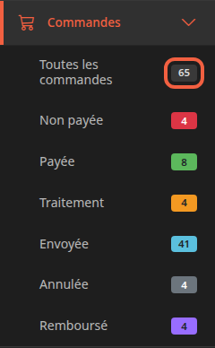
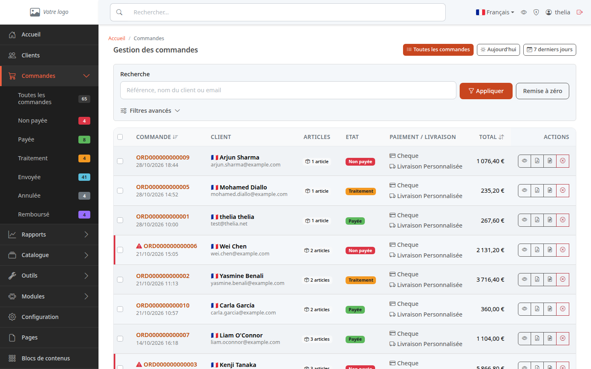
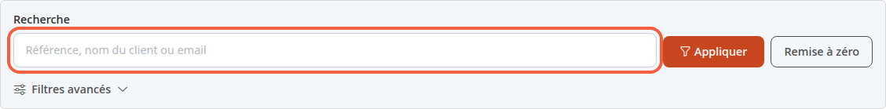
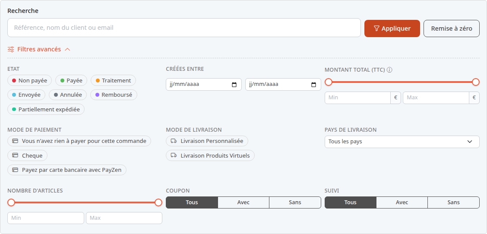
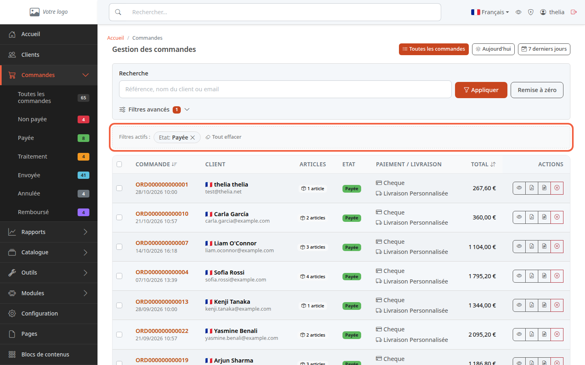

Une commande arrive dès qu'un client valide son panier sur votre boutique. La liste des commandes vous dit lesquelles attendent un paiement, lesquelles sont à traiter et lesquelles sont parties.

**Avant de commencer :** il vous faut un accès au [back-office](/getting-started/back-office-tour/) et, pour voir des lignes, au moins une commande dans la boutique.

## Étape 1 : ouvrir la liste

1. Dans le menu à gauche, cliquez sur **Commandes**.
2. Cliquez sur **Toutes les commandes**.

Le sous-menu **Commandes** affiche un compteur à droite de chaque ligne. Dans la boutique de démonstration, 65 commandes ont été passées.

Le compteur d'une ligne donne le nombre de commandes qui portent ce statut. Un statut est l'étape où en est la commande, par exemple **Payée** ou **Envoyée**. Un statut qui n'a aucune commande n'apparaît pas dans le menu.

## Étape 2 : comprendre les statuts

Chaque commande porte un statut, affiché dans la colonne **ETAT** et sous forme de pastille colorée. Voici ceux que vous voyez avec une boutique neuve :

- **Non payée** : la commande est enregistrée, le paiement n'est pas encore reçu. Une commande passée il y a plus de 48 heures et toujours non payée porte un triangle rouge devant sa référence.
- **Payée** : le paiement est enregistré. La date de facture est posée à ce moment-là.
- **Traitement** : la commande est payée et en cours de traitement. Thelia la compte comme payée.
- **Envoyée** : le colis est parti. Thelia la compte aussi comme payée.
- **Annulée** : la commande a été annulée.
- **Remboursé** : la commande est marquée comme remboursée au client.
- **Partiellement expédiée** : une partie des colis est partie, le reste est à venir. Thelia la compte aussi comme payée. Ce statut ne figure dans le menu que lorsqu'une commande l'a.

Votre boutique peut avoir d'autres statuts, ajoutés par vous : ils apparaissent d'eux-mêmes dans le menu. Pour faire passer une commande d'un statut à l'autre, voir [Faire avancer une commande](/orders/process-order/).

## Étape 3 : lire la liste

La liste affiche 25 commandes par page, les plus récentes en premier.

Chaque ligne contient :

- **COMMANDE** : la référence de la commande, qui ouvre son détail, et la date à laquelle elle a été passée ;
- **CLIENT** : son nom et son adresse e-mail ;
- **ARTICLES** : le nombre de produits différents de la commande. Un produit commandé en 3 exemplaires compte pour 1 ;
- **ETAT** : le statut ;
- **PAIEMENT / LIVRAISON** : le moyen de paiement choisi, par exemple Cheque, et le mode de livraison ;
- **TOTAL** : le montant total de la commande ;
- **ACTIONS** : jusqu'à quatre boutons, dans l'ordre : **Voir la commande**, **Télécharger la facture PDF**, **Télécharger le bon de livraison PDF** et **Annuler la commande**, absent quand la commande ne peut plus être annulée.

Un clic sur l'en-tête **COMMANDE** trie la liste par date de commande, un clic sur **TOTAL** par montant.

Pour ne voir qu'un statut, cliquez sur ce statut dans le menu, par exemple **Payée**.

Pour lire le contenu d'une commande, voir [Lire le détail d'une commande](/orders/read-order/).

## Étape 4 : retrouver une commande

En haut de la page, trois boutons filtrent par date :

- **Toutes les commandes** : aucune limite ;
- **Aujourd'hui** : les commandes du jour ;
- **7 derniers jours** : les commandes d'aujourd'hui et des six jours précédents.

Pour chercher une commande précise :

1. Cliquez dans le champ **Recherche**.
2. Saisissez une référence, un nom de client ou une adresse e-mail, par exemple `Rossi`.
3. Cliquez sur **Appliquer**.

Pour revenir à la liste complète, cliquez sur **Remise à zéro**.

## Étape 5 : affiner avec les filtres avancés

1. Cliquez sur **Filtres avancés**. Le panneau s'ouvre.
2. Choisissez un ou plusieurs critères.
3. Cliquez sur **Appliquer**.

Les critères proposés :

- **ETAT** : cochez un ou plusieurs statuts ;
- **CRÉÉES ENTRE** : une date de début et une date de fin ;
- **MONTANT TOTAL (TTC)** : un minimum et un maximum. TTC veut dire taxes comprises. Le montant inclut les frais de port et les remises ;
- **MODE DE PAIEMENT** et **MODE DE LIVRAISON** : cochez ceux qui vous intéressent ;
- **PAYS DE LIVRAISON** : un pays dans la liste ;
- **NOMBRE D'ARTICLES** : un minimum et un maximum de produits différents ;
- **COUPON** : **Tous**, **Avec** ou **Sans** code promo ;
- **SUIVI** : **Tous**, **Avec** ou **Sans** numéro de suivi de colis.

Les filtres en cours s'affichent dans une bande **Filtres actifs**. Cliquez sur la croix d'un filtre pour le retirer, ou sur **Tout effacer** pour les retirer tous.

Si rien ne correspond, la liste affiche **Aucune commande ne correspond aux filtres actuels.**

Pour changer le statut de plusieurs commandes d'un coup, cochez leurs cases dans la liste : une barre **Passer les commandes sélectionnées en** apparaît. Le détail est dans [Faire avancer une commande](/orders/process-order/).

## Le résultat

Vous retrouvez une commande par son numéro, son client, sa date ou son statut. Les compteurs du menu **Commandes** vous donnent d'un coup d'œil ce qui attend un paiement ou un envoi.
