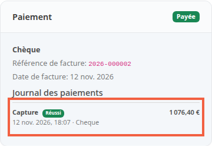

Le journal des paiements garde la trace de chaque mouvement d'argent d'une commande : autorisation, capture, libération. Il vous dit ce que la banque a réservé, ce qui a été encaissé et ce qui reste à prendre.

Une autorisation est un montant que la banque du client réserve sans le débiter. La capture est le geste qui le débite vraiment. Certains modules de paiement séparent les deux : vous autorisez à la commande, vous encaissez à l'expédition, par exemple.

**Avant de commencer :** une commande payée. Pour capturer, il faut en plus un module de paiement qui autorise d'abord et un compte administrateur qui a le droit de capturer (étape 4).

## Étape 1 : ouvrir le journal d'une commande

1. Dans le menu de gauche, cliquez sur **Commandes**, puis ouvrez une commande.
2. Dans la colonne de droite, repérez la carte **Paiement**.
3. Sous **Journal des paiements**, lisez les lignes. La plus récente est en haut.

Chaque ligne indique :

- le type de mouvement : **Autorisation**, **Capture** ou **Annulation** (la libération d'un montant réservé) ;
- son état : **Réussi**, **En attente** ou **En échec** ;
- le montant, la date, l'auteur (le module de paiement ou un administrateur) et la référence donnée par le prestataire de paiement.

Une commande passée avant la mise à jour vers la 3.4 n'a pas de journal. La carte affiche **Aucun mouvement de paiement enregistré pour cette commande**.

## Étape 2 : comprendre ce que le journal écrit seul

Un module qui prend l'argent tout de suite, comme le chèque, ne dit à la boutique que « payée ». Dès que la commande passe de non payée à payée, la boutique écrit une ligne **Capture** du montant total. La référence du prestataire reste vide pour ce cas.

Cela vaut aussi quand vous passez vous-même la commande en **Payée** à la réception d'un chèque. Une même commande n'écrit pas deux fois cette ligne.

## Étape 3 : encaisser une autorisation

Avec un module qui autorise d'abord, la commande arrive au statut **En attente de capture**. Ce statut compte comme non payé : la commande n'est pas payée tant que l'argent n'est pas pris.

1. Ouvrez la commande. La carte **Paiement** affiche **Autorisé**, **Capturé** et **Reste à capturer**.
2. Un avertissement le rappelle : passer la commande en payée à la main ne prélève rien.
3. Cliquez sur **Capturer le paiement**.
4. Dans la fenêtre, **Montant à capturer** est rempli avec ce qui reste. Gardez-le pour tout prendre, ou saisissez un montant plus petit.
5. Cliquez sur **Capturer maintenant**.

Une capture partielle laisse le reste à capturer plus tard et la commande **En attente de capture**. Quand il ne reste plus rien à capturer, la commande passe en **Payée**. La boutique refuse un montant supérieur à ce que l'autorisation réserve, ou nul.

Si vous demandez deux fois le même montant en moins d'une minute, la seconde demande est refusée : un double clic ne prélève pas deux fois.

Certains prestataires ne prennent qu'une capture par autorisation. La fenêtre le dit : ce qui n'est pas capturé est libéré avec elle.

## Étape 4 : donner le droit de capturer

Capturer est un droit à part, **Capture du paiement d'une commande**. Après la mise à jour, aucun profil ne l'a : seul le super-administrateur capture. Ajoutez ce droit, en création, aux profils qui doivent encaisser.

Sans ce droit, un administrateur voit la carte et le journal mais pas le bouton **Capturer le paiement**. Il ne peut pas non plus annuler une commande dont l'autorisation réserve encore un montant.

## Quand le prestataire refuse ou ne répond pas

- **Refus.** La ligne passe **En échec**. Le code et le message du prestataire s'affichent en rouge dessous. Le montant reste capturable : vous pouvez réessayer.
- **Pas de réponse.** La ligne reste **En attente** et la boutique ne la compte pas comme échouée. Quand le prestataire confirme, la ligne se règle d'elle-même.
- **Réponse lue chez le prestataire.** Sur une ligne **En attente**, un administrateur qui a le droit de capturer peut saisir ce qu'il lit dans l'espace du prestataire. Dans **Issue constatée chez le prestataire**, il indique **Réussi** ou **Refusé**, avec la référence si elle est connue.

## Annuler une commande autorisée

Annuler une commande dont l'autorisation réserve encore un montant libère ce montant : une ligne **Annulation** s'ajoute au journal, et **Libéré** apparaît dans les totaux. Il faut pour cela le droit de capturer.

## Le résultat

La carte **Paiement** de chaque commande dit où en est l'argent, ligne par ligne, avec qui a fait quoi. Pour une commande autorisée, les totaux **Autorisé**, **Capturé** et **Reste à capturer** se mettent à jour à chaque capture.
