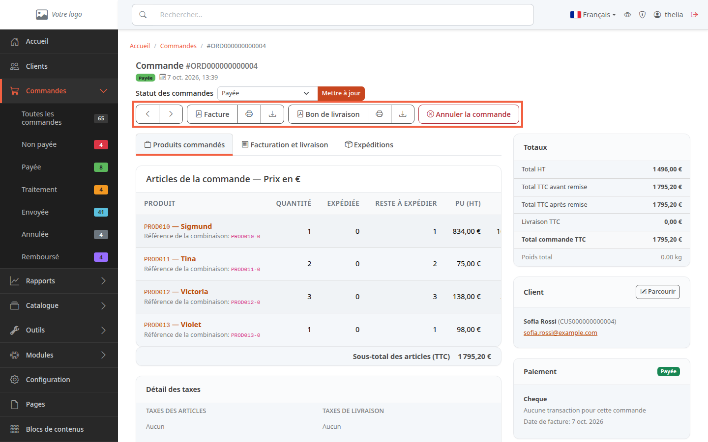
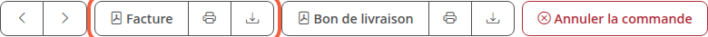
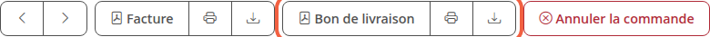

La facture est le document que vous remettez au client pour une commande payée. Le bon de livraison l'accompagne dans le colis. Ce tutoriel montre où les afficher, les imprimer et les enregistrer en PDF.

**Avant de commencer :** il vous faut une commande, voir [Suivre ses commandes](/orders/list-orders/). Pour la facture, la commande doit être payée.

## Étape 1 : ouvrir la commande

1. Dans le menu à gauche, cliquez sur **Commandes**, puis sur **Toutes les commandes**.
2. Cliquez sur la référence de la commande, par exemple **ORD000000000004**.

Les boutons se trouvent en haut de la page, sous le statut de la commande.

## Étape 2 : afficher, imprimer ou télécharger la facture

Le groupe **Facture** contient trois boutons.

1. Cliquez sur **Facture** pour ouvrir le PDF dans un nouvel onglet. L'info-bulle indique **Voir la facture PDF**.
2. Cliquez sur l'icône imprimante pour ouvrir la fenêtre d'impression de votre navigateur (**Imprimer la facture**).
3. Cliquez sur l'icône de téléchargement pour enregistrer le PDF sur votre ordinateur (**Télécharger la facture en PDF**). Le fichier se nomme `invoice-` suivi de la référence de la commande, par exemple `invoice-ORD000000000004.pdf`.

La facture porte la date de facturation, le numéro de facture, le numéro de client, et les adresses de livraison et de facturation.

## Étape 3 : afficher, imprimer ou télécharger le bon de livraison

Le groupe **Bon de livraison** fonctionne de la même façon.

1. Cliquez sur **Bon de livraison** pour ouvrir le PDF dans un nouvel onglet.
2. Cliquez sur l'icône imprimante pour l'imprimer.
3. Cliquez sur l'icône de téléchargement pour l'enregistrer. Le fichier se nomme `delivery-` suivi de la référence, par exemple `delivery-ORD000000000004.pdf`.

Le bon de livraison reprend la date de facturation, le numéro de commande, le numéro de client et les deux adresses. Il est toujours disponible, que la commande soit payée ou non.

Les info-bulles de ces trois boutons parlent de « bon de commande » (**Voir le bon de commande en PDF**) : il s'agit du même document.

## Étape 4 : comprendre quand la facture est disponible

Le bouton **Facture** n'apparaît pas sur toute commande. Il est affiché dans deux cas :

- la commande est **Payée**, en **Traitement**, **Envoyée** ou **Partiellement expédiée** ;
- ou elle a déjà une date de facture, par exemple parce qu'elle a été payée avant d'être remboursée.

Sur une commande **Non payée**, il n'y a que le bon de livraison.

La date de facture est posée au moment où la commande passe pour la première fois à un statut payé. Une commande payée a donc toujours sa facture.

Le numéro de facture est attribué à ce moment-là, dans l'ordre : `2026-000001`, `2026-000002`, et ainsi de suite. Chaque année commence une nouvelle série à `000001`. Cette numérotation est active sur une boutique installée neuve. Elle est inactive sur une boutique migrée depuis Thelia 2.

Quand une commande payée n'a pas de numéro de facture enregistré, le PDF en fabrique un à partir du numéro de commande. C'est le cas des commandes de démonstration : la facture de ORD000000000004 porte le numéro `FA000000000004`.

Pour retrouver les documents sans ouvrir la commande, la liste des commandes propose les mêmes PDF dans la colonne **ACTIONS** : **Télécharger la facture PDF** et **Télécharger le bon de livraison PDF**. Attention, la liste propose la facture même pour une commande non payée : ce PDF n'a alors ni date de facturation ni numéro de facture.

## Le résultat

Le PDF s'ouvre dans un onglet, part à l'impression, ou arrive dans le dossier de téléchargements de votre navigateur. Il porte les informations de la commande.
