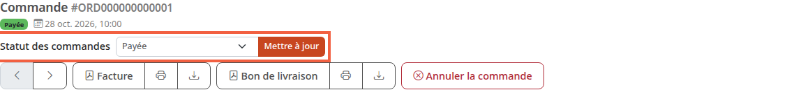
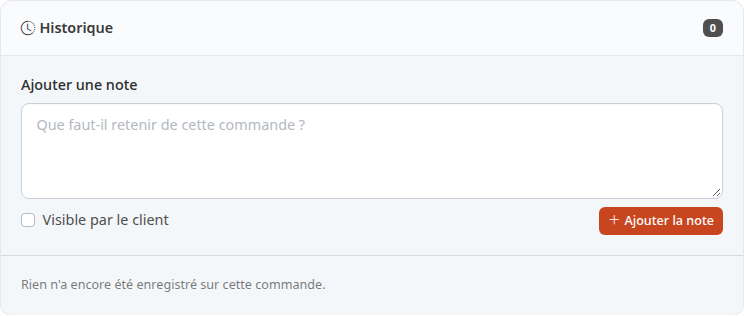

Le statut d'une commande dit où elle en est : à payer, payée, en préparation, expédiée. Vous le changez à la main au fil du traitement, pour que vous et votre client sachiez où en est la commande.

**Avant de commencer :** il faut au moins une commande dans la boutique. Pour la retrouver, voyez [Suivre ses commandes](/orders/list-orders/).

## Étape 1 : ouvrir la commande

1. Dans le menu, cliquez sur **Commandes**.
2. Cliquez sur la commande à traiter, par exemple ORD000000000001.

La page de la commande s'ouvre. Pour comprendre ses blocs, voyez [Lire le détail d'une commande](/orders/read-order/).

## Étape 2 : choisir le nouveau statut

Le statut se change en haut de la page, sous la référence de la commande.

1. Repérez la ligne **Statut des commandes**.
2. Ouvrez la liste déroulante. Elle affiche d'abord le statut actuel (ici **Payée**), puis les statuts que vous pouvez choisir.
3. Cliquez sur le statut voulu, par exemple **Traitement** pour dire que vous préparez le colis.

Les statuts livrés avec Thelia sont **Non payée**, **Payée**, **Traitement**, **Envoyée**, **Annulée**, **Remboursé** et **Partiellement expédiée**.

## Étape 3 : enregistrer le changement

1. Cliquez sur **Mettre à jour**, à droite de la liste.

La page se recharge avec le nouveau statut dans la liste. Vérifiez-le à l'étape suivante.

Si le colis part, le tutoriel [Expédier une commande et saisir le suivi du colis](/orders/ship-order/) ajoute le numéro de suivi.

## Étape 4 : vérifier dans l'historique

Plus bas sur la page, le bloc d'historique garde une ligne par changement de statut. Sur la capture, il est vide : **Rien n'a encore été enregistré sur cette commande.**

## Quels statuts sont proposés

Selon la configuration de la boutique, la liste ne propose pas toujours tous les statuts.

- Tant qu'aucun passage n'est réglé depuis le statut actuel, la commande peut aller vers n'importe quel statut.
- Dès qu'au moins un passage est réglé depuis ce statut, seuls les statuts autorisés sont listés. Une ligne sous la liste l'indique : **Seuls les statuts autorisés depuis le statut actuel sont proposés.**
- Si aucun passage n'est autorisé, la liste et le bouton sont grisés et la ligne indique : **Aucune transition n'est autorisée depuis le statut actuel.**

Ce réglage n'est pas décrit ici : si un statut dont vous avez besoin manque, demandez à la personne qui administre la boutique.

## Ce que déclenche le changement

- **Historique :** chaque changement est inscrit dans l'historique de la commande.
- **E-mail au client :** quand la commande passe à **Envoyée**, Thelia envoie au client un e-mail d'expédition, sauf si la case **Envoyer un e-mail au client quand sa commande est expédiée** est décochée dans [Informations de la boutique](/getting-started/store-info/). Un module de livraison peut envoyer le sien, que cette case ne commande pas. Les détails sont dans [Expédier une commande et saisir le suivi du colis](/orders/ship-order/).
- **Expédition :** au passage à **Envoyée**, les colis en **Brouillon** partent d'abord, chacun comme un colis distinct. Tout ce qui reste à expédier part ensuite en un seul colis, qui reprend la référence de suivi de la commande. Pour saisir le numéro de suivi d'abord, passez par l'onglet **Expéditions** (voir le même tutoriel).
- **Numéro de facture :** avec le réglage livré par défaut, une commande qui passe à un statut payé (**Payée**, **Traitement**, **Envoyée** ou **Partiellement expédiée**) sans numéro de facture en reçoit un.
- **Stock :** Thelia compte comme payée une commande **Payée**, **Traitement**, **Envoyée** ou **Partiellement expédiée**. Quand elle quitte ces statuts, par exemple pour **Annulée**, ses produits sont remis en stock. Quand la commande revient ensuite à un statut payé, ils sont de nouveau retirés du stock.

## Le résultat

La commande affiche son nouveau statut en haut de page, et l'historique en garde la trace.
