Une commande rassemble tout ce qu'il faut pour préparer un colis : les produits achetés, les adresses, le paiement et la livraison. Ce tutoriel vous guide dans cet écran bloc par bloc, avec la commande de démonstration ORD000000000004.

**Avant de commencer :** il vous faut une commande dans la boutique. Pour la retrouver, voir [Suivre ses commandes](/orders/list-orders/).

## Étape 1 : ouvrir la commande

1. Dans le menu à gauche, cliquez sur **Commandes**, puis sur **Toutes les commandes**.
2. Cliquez sur la référence de la commande, par exemple **ORD000000000004**.

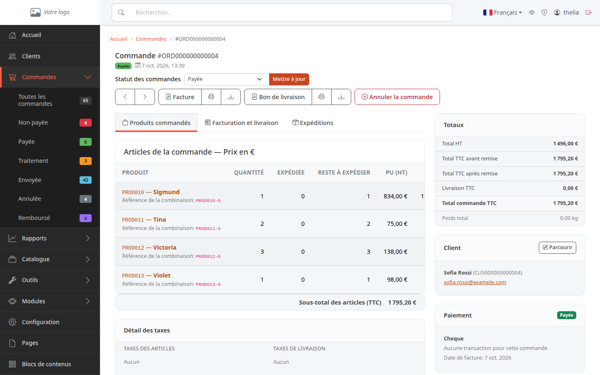

La page se lit en deux colonnes. À gauche, trois onglets et l'historique. À droite, les totaux, le client, le paiement et la livraison.

## Étape 2 : lire l'en-tête

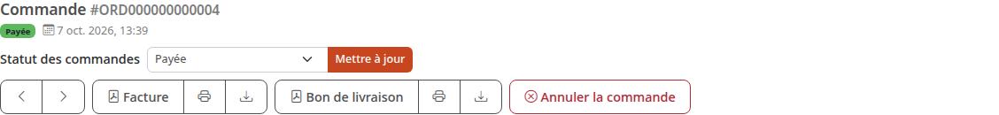

De haut en bas :

- le titre **Commande** et sa référence ;
- une pastille avec le statut (ici **Payée**) et la date à laquelle le client a commandé ;
- la liste **Statut des commandes** et le bouton **Mettre à jour**, qui servent à faire avancer la commande : voir [Faire avancer une commande](/orders/process-order/) ;
- les deux flèches, qui ouvrent la commande précédente ou la suivante ;
- les boutons **Facture**, présent sur une commande payée, même annulée ou remboursée depuis, et **Bon de livraison** : voir [Imprimer la facture et le bon de livraison](/orders/print-documents/) ;
- le bouton **Annuler la commande**, qui n'apparaît que si la commande peut encore être annulée.

## Étape 3 : lire les produits commandés

L'onglet **Produits commandés** est ouvert d'office. Il liste ce que le client a acheté.

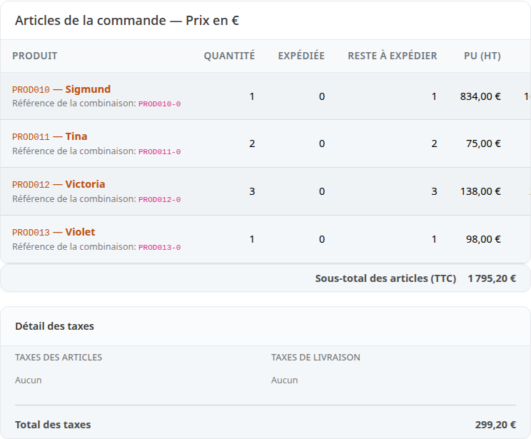

Chaque ligne indique le produit, avec sa référence, par exemple **PROD010**. Un clic sur le nom ouvre la fiche du produit. Les colonnes se lisent ainsi :

- **QUANTITÉ** : le nombre d'exemplaires commandés ;
- **EXPÉDIÉE** : le nombre déjà parti ;
- **RESTE À EXPÉDIER** : ce qui reste à envoyer ;
- **PU (HT)** : le prix d'une unité sans les taxes ;
- **TAXE**, **PU (TTC)**, **TOTAL (HT)**, **TAXE SUR LA LIGNE** et **TOTAL (TTC)** : ces colonnes sont plus à droite. Faites défiler le tableau vers la droite pour les voir.

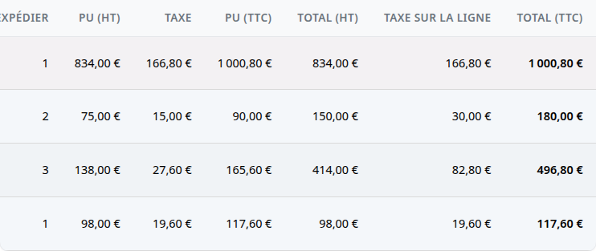

HT veut dire hors taxes, TTC taxes comprises. Une taxe est la TVA : voir [Régler la TVA](/settings/tax-rules/).

Sous le tableau, **Sous-total des articles (TTC)** donne le total des lignes, puis le bloc **Détail des taxes** liste les taxes des articles et de la livraison.

## Étape 4 : vérifier les adresses

1. Cliquez sur l'onglet **Facturation et livraison**.

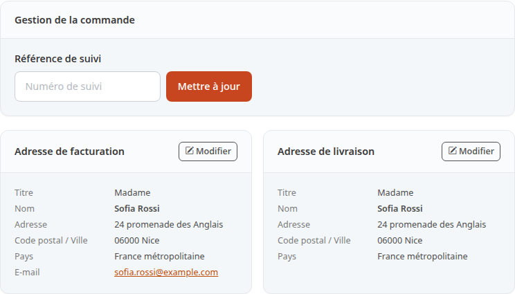

L'onglet contient :

- **Gestion de la commande** : le champ **Référence de suivi**, où se saisit le numéro de suivi du colis ;
- **Adresse de facturation** : le nom et l'adresse à mettre sur la facture ;
- **Adresse de livraison** : l'adresse où envoyer le colis.

Chaque adresse affiche le titre (**Madame**), le nom, l'adresse, le code postal et la ville, le pays. Le bouton **Modifier** permet de corriger une adresse.

## Étape 5 : suivre les expéditions

1. Cliquez sur l'onglet **Expéditions**.

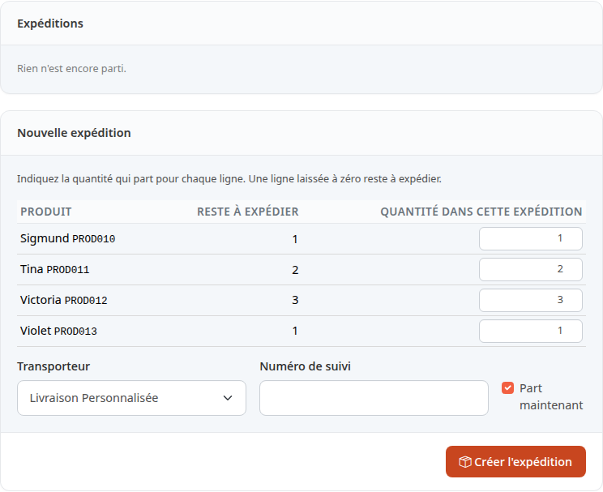

Le bloc **Expéditions** liste les colis déclarés pour cette commande, avec leur état. Tant qu'aucun colis n'est déclaré, il affiche **Rien n'est encore parti.** Le bloc **Nouvelle expédition** sert à déclarer un colis : voir [Expédier une commande](/orders/ship-order/).

La capture suivante montre une autre commande, ORD000000000005, expédiée pour l'exemple. Une ligne par colis donne :

- sa référence, **ORD000000000005-1**, et la date de départ (**Expédiée le** …) ;
- son état, **Expédiée** ;
- le transporteur, avec le numéro de suivi dessous ;
- les produits du colis, avec leur quantité.

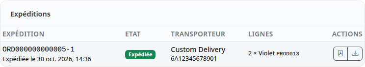

## Étape 6 : lire la colonne de droite

Le bloc **Totaux** résume les montants.

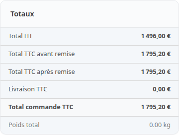

- **Total HT** : la somme des produits sans taxe ;
- **Total TTC avant remise** : la même somme, taxes comprises ;
- **Remise TTC** : le montant des remises, affiché seulement quand la commande en a une ;
- **Total TTC après remise** : le montant une fois les remises déduites. Il est identique au précédent quand le client n'a pas de remise ;
- **Livraison TTC** : les frais de port ;
- **Total commande TTC** : ce que le client doit payer ;
- **Poids total** : le poids des produits.

Plus bas, le bloc **Client** donne son nom, sa référence et son adresse e-mail. Le bouton **Parcourir** ouvre sa fiche.

Le bloc **Paiement** indique le moyen choisi, ici **Cheque**, et si la commande est payée.

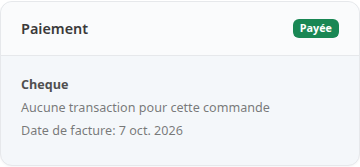

Il affiche aussi la **Référence de transaction** quand le paiement en a une (ici **Aucune transaction pour cette commande**). Une fois la commande payée, il ajoute la **Date de facture**, et la **Référence de facture** quand un numéro de facture a été attribué.

Le bloc **Livraison** donne le mode de livraison choisi, ici **Livraison Personnalisée**. Il ajoute la **Référence de suivi** une fois saisie.

Selon la commande, d'autres blocs s'ajoutent : **Codes promo** si le client en a utilisé, **Cadeau** s'il a choisi un service cadeau ou écrit un message pour le destinataire, **Consentements** quand il a accepté ou refusé des consentements pendant la commande.

Tout en bas de la colonne de gauche, le bloc **Historique** garde la trace de ce qui s'est passé sur la commande, la plus récente en premier. Le champ **Ajouter une note** permet d'y écrire un commentaire.

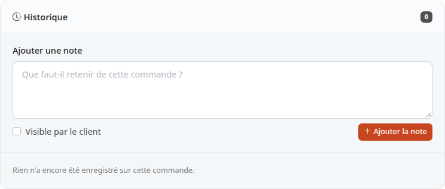

Sur cette commande, le bloc est vide (compteur à 0). Sur ORD000000000005, expédiée pour l'exemple, il compte six lignes. Chacune dit ce qui s'est passé, qui l'a fait et quand, par exemple **Statut : Traitement → Envoyée** ou **Référence de suivi : 6A12345678901**.

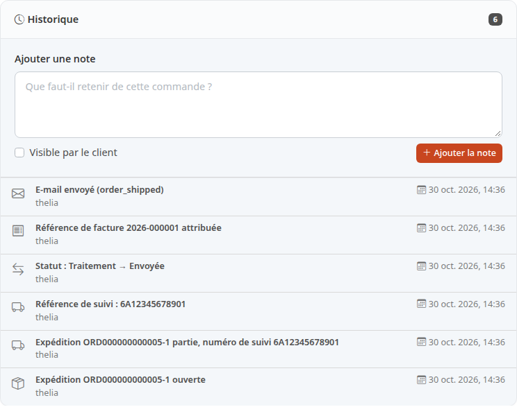

## Le résultat

Vous savez où trouver chaque information : les produits dans le premier onglet, les adresses dans le deuxième, les colis dans le troisième, les montants et le paiement à droite.
