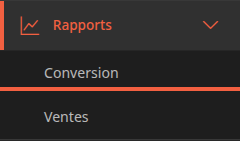
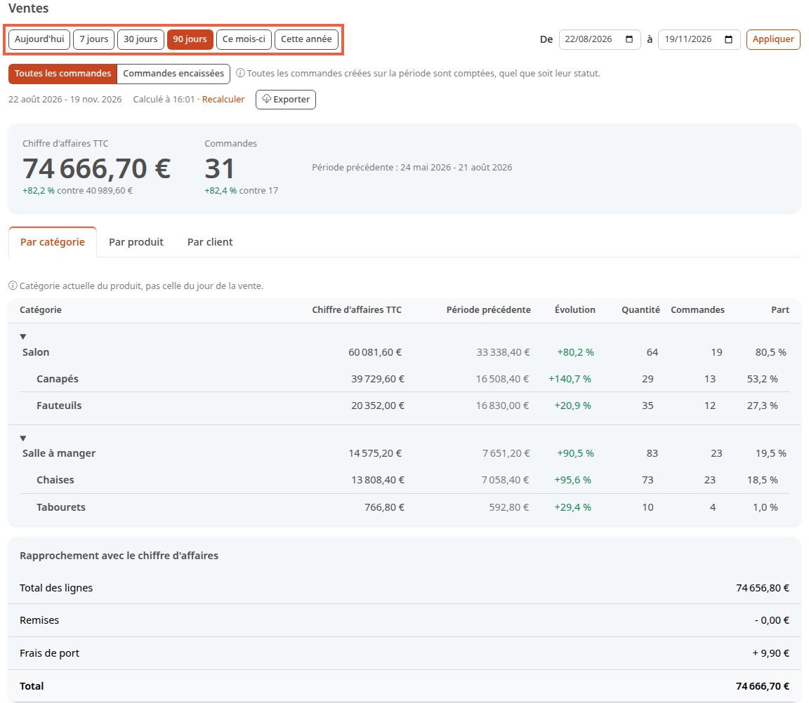
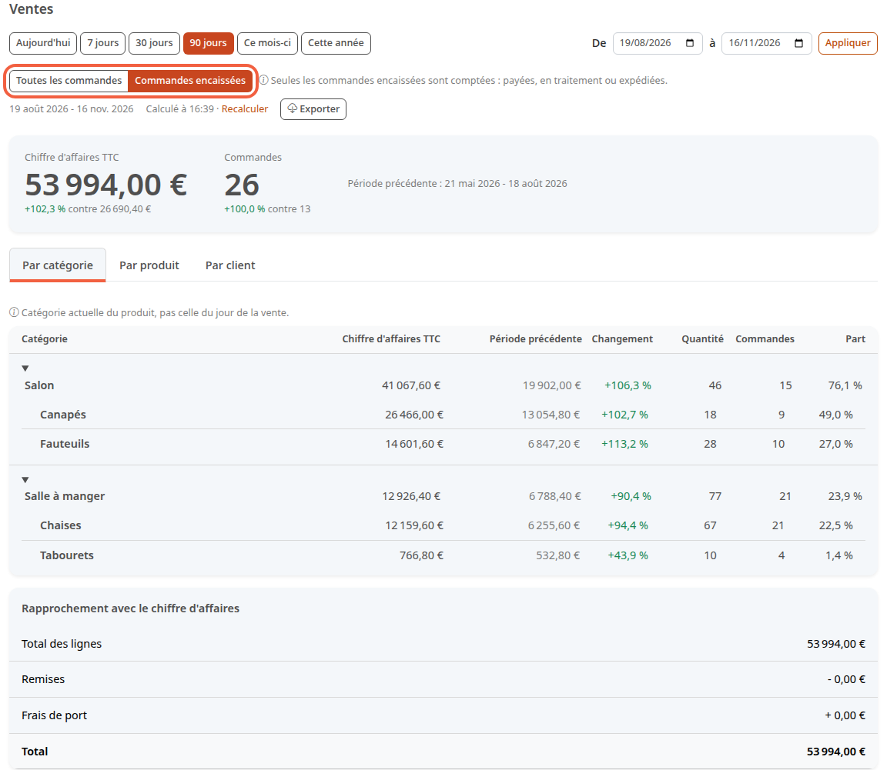
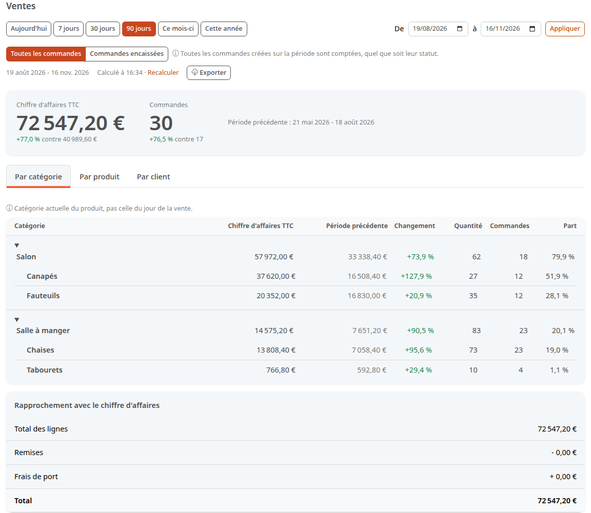
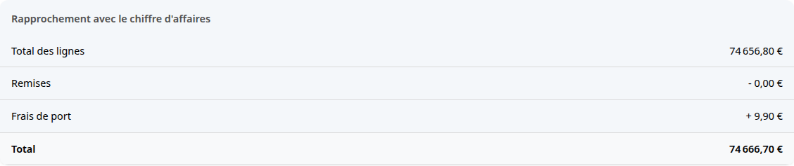
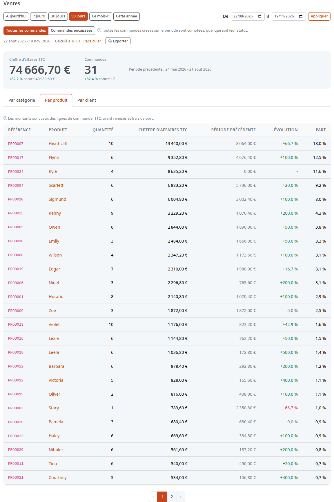
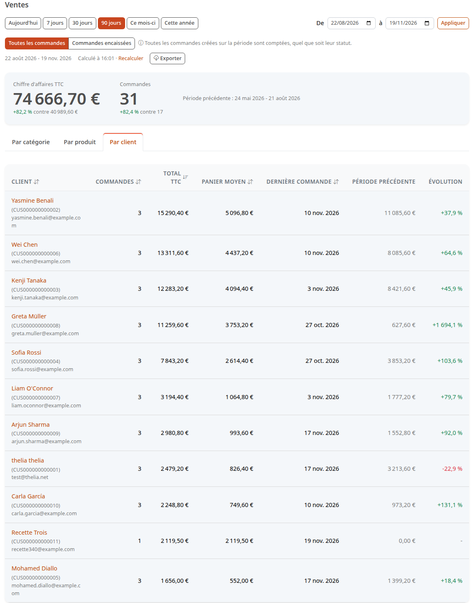
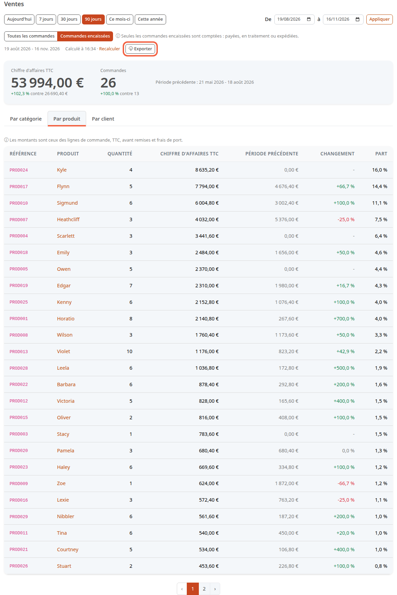

Le rapport des ventes montre ce que la boutique a vendu sur une période, classé par catégorie, par produit ou par client, et le compare à la période précédente. Il sert à repérer ce qui porte le chiffre d'affaires et ce qui recule.

**Avant de commencer :** la boutique a des commandes. Les onglets **Par catégorie** et **Par produit** demandent le droit sur les commandes (`admin.order`), l'onglet **Par client** le droit sur les clients (`admin.customer`), le bouton **Exporter** le droit d'export (`admin.export`). Un onglet que votre profil ne peut pas lire n'est pas proposé.

## Étape 1 : ouvrir le rapport

1. Dans le menu de gauche, cliquez sur **Rapports**.
2. Cliquez sur **Ventes**.

Si votre profil a le droit sur les clients mais pas sur les commandes, le menu **Rapports** ne contient que **Ventes**, et l'écran s'ouvre sur **Par client**.

## Étape 2 : choisir la période

1. Cliquez sur **Aujourd'hui**, **7 jours**, **30 jours**, **90 jours**, **Ce mois-ci** ou **Cette année**. Sans choix, l'écran affiche les 30 derniers jours.
2. Pour des dates précises, saisissez-les dans **De** et **à**, puis cliquez sur **Appliquer**.

Les dates vont jusqu'à aujourd'hui, sur trois ans au plus. Des dates refusées ramènent à 30 jours.

En haut, le **Chiffre d'affaires TTC** et le nombre de **Commandes** sont comparés à la **Période précédente** : elle finit la veille du début de la vôtre et dure autant de jours. Une hausse s'affiche en vert avec son pourcentage, un recul en rouge.

## Étape 3 : choisir les commandes comptées

Deux boutons règlent ce qui est compté :

- **Toutes les commandes** (réglage de départ) compte toutes les commandes créées sur la période, quel que soit leur statut, annulées comprises ;
- **Commandes encaissées** ne compte que les commandes payées, en traitement ou expédiées.

1. Cliquez sur **Commandes encaissées**.

Une phrase à droite des boutons rappelle ce qui est compté. Un statut que vous avez créé compte comme encaissé si son code équivalent est payé, en traitement ou expédié. Un administrateur rattaché à certaines unités de vente ne voit que les commandes de ces unités.

## Étape 4 : lire les ventes par catégorie

1. Cliquez sur l'onglet **Par catégorie**.

Chaque ligne est une catégorie, avec son **Chiffre d'affaires TTC**, la **Période précédente**, l'**Évolution**, la **Quantité** vendue, le nombre de **Commandes** et sa **Part** du total. Une catégorie additionne ses sous-catégories : **Salon** inclut **Canapés** et **Fauteuils**. Cliquez sur la flèche d'une catégorie pour replier ses sous-catégories.

Trois règles à connaître :

- un produit est compté dans sa catégorie par défaut seulement, donc une vente n'est comptée qu'une fois ;
- la catégorie est celle du produit aujourd'hui, pas celle du jour de la vente ;
- les produits supprimés ou sans catégorie sont sous **Produits sans catégorie**, les lignes de service, comme un emballage cadeau, sous **Services**.

Sous l'arbre, le tableau **Rapprochement avec le chiffre d'affaires** passe du **Total des lignes** au **Total** en retirant les **Remises** et en ajoutant les **Frais de port**. Ce total est le chiffre d'affaires de l'accueil pour la même période.

## Étape 5 : lire les ventes par produit

1. Cliquez sur l'onglet **Par produit**.

Chaque produit vendu apparaît avec sa **Référence**, la **Quantité**, le **Chiffre d'affaires TTC**, la **Période précédente**, l'**Évolution** et sa **Part**. Les meilleures ventes sont en tête, 25 produits par page. Les montants sont ceux des lignes de commande, avant remises et frais de port. Une quantité vendue au poids garde ses décimales : 0,4 kg s'affiche 0,4.

Cliquez sur le nom d'un produit pour ouvrir sa fiche, si votre profil peut voir les produits.

## Étape 6 : lire les ventes par client

1. Cliquez sur l'onglet **Par client**.

Chaque client qui a commandé sur la période apparaît avec son nombre de **Commandes**, son **Total TTC**, son **Panier moyen** (le total divisé par le nombre de commandes), sa **Dernière commande**, la **Période précédente** et l'**Évolution**. Le plus gros total est en tête, 25 clients par page. Cliquez sur un titre de colonne pour trier dessus, et sur le nom d'un client pour ouvrir sa fiche.

## Étape 7 : exporter

1. Cliquez sur **Exporter**.

Le navigateur télécharge un fichier CSV de l'onglet affiché, pour les mêmes jours et les mêmes commandes que l'écran. Un tableur l'ouvre. Si le fichier demande du temps, une page de suivi s'affiche d'abord. Une période sans vente n'a rien à exporter. Pour les recevoir par e-mail à date fixe, voir [Programmer l'envoi de rapports par e-mail](/orders/schedule-email-reports/).

## Le résultat

Vous lisez le chiffre d'affaires de la période par catégorie, par produit et par client, avec l'évolution depuis la période précédente. Le calcul d'une période longue peut prendre quelques secondes : l'écran garde ses chiffres 15 minutes, indique **Calculé à** l'heure du calcul, et **Recalculer** les refait. Une commande passée, modifiée ou supprimée les renouvelle d'elle-même.
