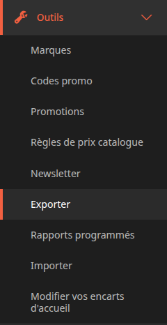
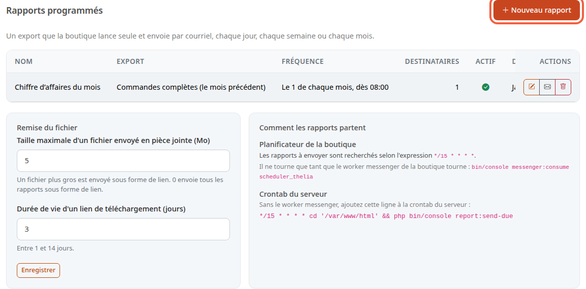
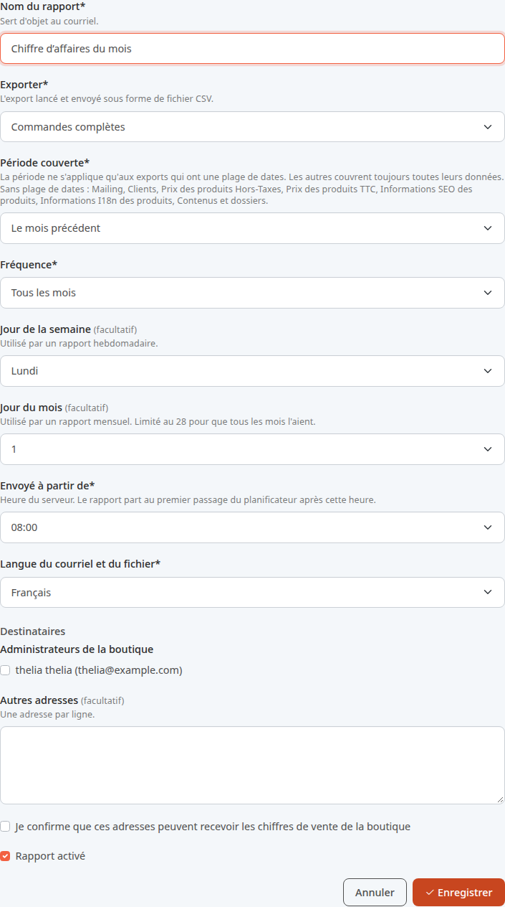
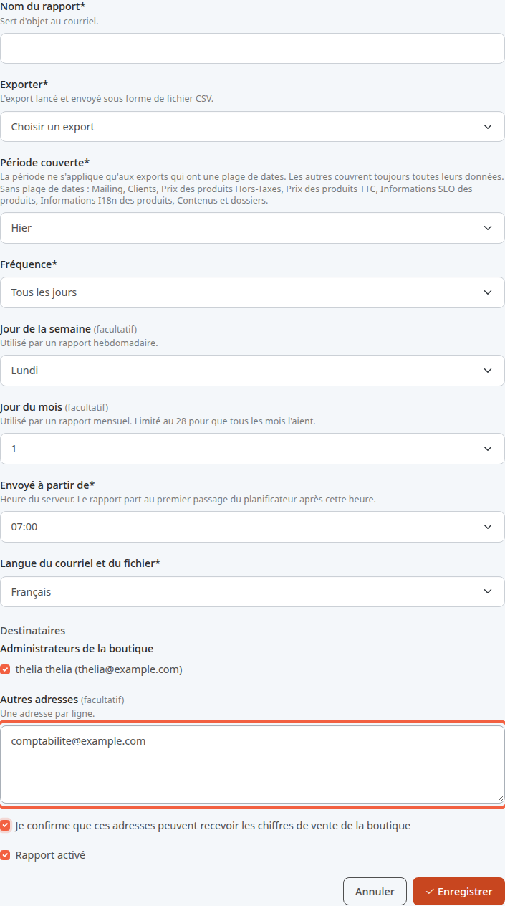
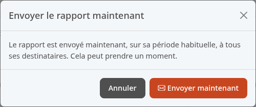
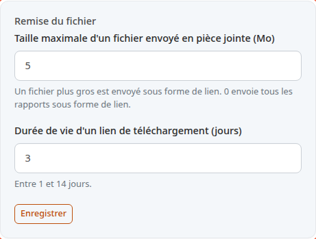
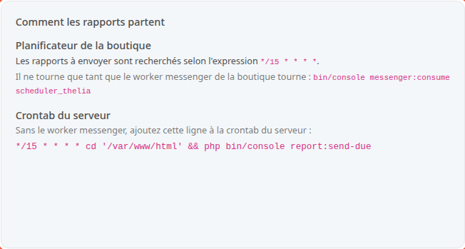

Un rapport programmé est un export que la boutique lance et envoie par e-mail toute seule, par exemple le lundi matin. Vous recevez les ventes de la semaine sans ouvrir le back-office.

Un export est un fichier de données de votre boutique, comme la liste des commandes. Le rapport l'envoie sous forme de fichier CSV, lisible dans un tableur.

**Avant de commencer :** l'envoi d'e-mails de la boutique fonctionne (voir [Vérifier l'envoi des e-mails de la boutique](/settings/mailing-test/)). Pour que les envois automatiques partent, votre hébergeur ou la personne qui gère votre serveur doit aussi avoir réglé l'étape 7.

## Étape 1 : ouvrir l'écran

1. Dans le menu de gauche, cliquez sur **Outils**.
2. Cliquez sur **Rapports programmés**.

L'écran liste vos rapports. Une ligne par rapport : son nom, l'export, le rythme et le nombre de destinataires. Le tableau défile vers la droite : les colonnes **Actif**, **Dernier envoi** et **Nouvelles tentatives en attente** s'y trouvent aussi.

Sur une ligne, l'interrupteur de la colonne **Actif** arrête ou relance un rapport. Les trois boutons de droite modifient le rapport, l'envoient maintenant ou le suppriment.

## Étape 2 : créer le rapport

1. Cliquez sur **Nouveau rapport**.
2. Dans **Nom du rapport**, saisissez par exemple `Chiffre d’affaires du mois`. Ce nom sert d'objet à l'e-mail.
3. Dans **Exporter**, choisissez l'export à envoyer, par exemple **Commandes complètes**.
4. Dans **Période couverte**, choisissez ce que le rapport contient, par exemple **Le mois précédent**.

La période est relative au jour d'envoi. Cinq choix :

- **Hier**
- **Les 7 derniers jours**
- **La semaine précédente (du lundi au dimanche)**
- **Le mois précédent**
- **Le mois en cours (jusqu'à hier)**

Certains exports n'ont pas de plage de dates : l'écran les liste sous le champ, avec **Sans plage de dates**. Ils envoient toujours toutes leurs données, quelle que soit la période.

## Étape 3 : choisir le rythme

1. Dans **Fréquence**, choisissez **Tous les jours**, **Toutes les semaines** ou **Tous les mois**.
2. Pour un rapport hebdomadaire, choisissez le jour dans **Jour de la semaine**, par exemple **Lundi**. Sinon, laissez ce champ tel quel.
3. Pour un rapport mensuel, choisissez le jour dans **Jour du mois**, par exemple 1, comme sur la capture. La liste s'arrête au 28 pour que tous les mois aient ce jour.
4. Dans **Envoyé à partir de**, choisissez l'heure, par exemple 08:00. C'est l'heure du serveur.
5. Dans **Langue du courriel et du fichier**, choisissez la langue, par exemple **Français**.

Le rapport ne part pas à l'heure pile : il part au premier passage du planificateur après cette heure (voir l'étape 7). Le planificateur de la boutique passe toutes les 15 minutes par défaut.

## Étape 4 : choisir les destinataires

1. Dans **Administrateurs de la boutique**, cochez les personnes qui reçoivent le rapport.
2. Pour une adresse hors de l'équipe, saisissez-la dans **Autres adresses**, une par ligne, par exemple `comptabilite@example.com`.
3. Cochez **Je confirme que ces adresses peuvent recevoir les chiffres de vente de la boutique**. Cette case est obligatoire dès que vous saisissez une autre adresse.
4. Laissez **Rapport activé** coché. Décochez-le pour arrêter le rapport sans le supprimer.
5. Cliquez sur **Enregistrer**.

Un rapport contient les chiffres de vente : n'envoyez-le qu'aux personnes qui peuvent les lire. Il faut au moins un destinataire. Une adresse mal écrite est signalée avant l'enregistrement.

## Étape 5 : envoyer le rapport tout de suite

Pour vérifier le contenu sans attendre l'heure prévue :

1. Dans la liste, cliquez sur le bouton en forme d'enveloppe de la ligne du rapport.
2. Lisez la fenêtre **Envoyer le rapport maintenant** : le rapport part sur sa période habituelle, à tous ses destinataires.
3. Cliquez sur **Envoyer maintenant**.

L'écran affiche ensuite combien de destinataires l'ont reçu, combien ont échoué et combien ont été rejetés, par exemple **Rapport envoyé à 1, échec pour 0, rejeté pour 0.** Un destinataire est rejeté quand son adresse n'est pas valide. Cet envoi ne demande ni planificateur ni crontab. Le rapport programmé continue de partir à son rythme.

## Ce que contient l'e-mail

L'objet de l'e-mail est le nom du rapport, suivi des dates de la période. Le texte rappelle la période et l'export. Le fichier CSV suit, joint ou en lien (étape suivante).

Pour deux exports, l'e-mail s'ouvre sur des chiffres clés :

- **Commandes complètes** : **Commandes**, **Commandes payées**, **Chiffre d'affaires TTC** et **Panier moyen**. Le panier moyen est le chiffre d'affaires divisé par le nombre de commandes payées.
- **Entonnoir de conversion** : **Paniers créés**, **Commandes créées**, **Commandes payées** et **Commandes payées sur commandes créées**.

Les autres exports n'ont pas de chiffres clés : l'e-mail porte le fichier seul. Quand la période ne contient aucune donnée, l'e-mail le dit et ne joint aucun fichier.

## Étape 6 : régler la remise du fichier

Un fichier trop gros ne passe pas toujours en pièce jointe. La boutique l'envoie alors sous forme de lien de téléchargement.

1. Dans **Taille maximale d'un fichier envoyé en pièce jointe (Mo)**, saisissez la taille limite, par exemple 5. Au-delà, le fichier part en lien. Avec 0, tous les rapports partent en lien. La valeur maximale est 100.
2. Dans **Durée de vie d'un lien de téléchargement (jours)**, saisissez la durée, par exemple 3. Elle va de 1 à 14 jours. Passé ce délai, le lien ne marche plus : l'e-mail indique la date d'expiration.
3. Cliquez sur **Enregistrer** sous ces deux champs.

Les réglages de départ sont 5 Mo et 3 jours. Ils valent pour tous les rapports.

## Étape 7 : faire partir les rapports automatiquement

Les rapports ne partent pas d'eux-mêmes : le serveur doit lancer régulièrement la recherche des rapports à envoyer. La carte **Comment les rapports partent** indique ce qu'il faut régler. Transmettez-la à la personne qui gère votre serveur.

Deux façons, au choix :

- **Le planificateur de la boutique.** Il cherche les rapports à envoyer selon l'expression affichée, `*/15 * * * *` au départ (toutes les 15 minutes). Il ne tourne que tant que le worker de la boutique tourne : la commande est affichée sur la carte.
- **La crontab du serveur.** La carte affiche aussi **Crontab du serveur** et la ligne à ajouter à la crontab si le worker ne tourne pas.

Si le module WebScheduler est actif, la carte propose à la place **Tâche WebScheduler**. Le bouton **Préparer la tâche WebScheduler** crée la tâche, et la carte donne l'adresse à appeler depuis les tâches planifiées de l'hébergeur.

Si la carte affiche **Le planificateur de la boutique ne recherche pas les rapports (expression vide)**, l'envoi automatique est désactivé.

Si l'envoi échoue pour un destinataire, la boutique réessaie aux passages suivants. Elle abandonne après trois essais. La colonne **Nouvelles tentatives en attente** indique combien de destinataires attendent un nouvel essai.

## Le résultat

Au jour et à l'heure choisis, les destinataires reçoivent l'e-mail avec les chiffres clés et le fichier. La colonne **Dernier envoi** de la liste indique la date du dernier envoi, ou **Jamais**.
