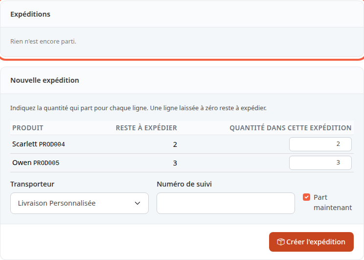
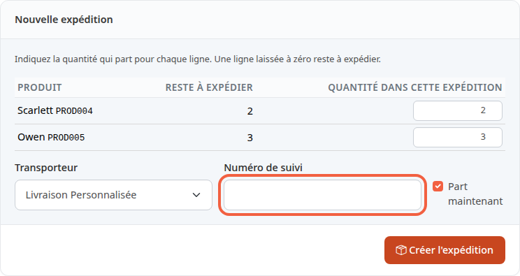
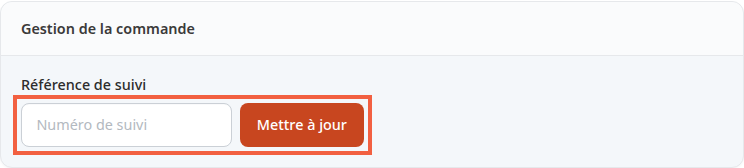

Une expédition correspond à un colis qui part de chez vous, avec son transporteur et son numéro de suivi. Vous l'enregistrez pour que la commande passe à **Envoyée** et que votre client sache que son colis est en route.

**Avant de commencer :** il faut une commande payée à préparer. Pour seulement changer son statut, voyez [Faire avancer une commande](/orders/process-order/).

## Étape 1 : ouvrir l'onglet Expéditions

1. Dans le menu, cliquez sur **Commandes**, puis sur la commande à expédier, par exemple ORD000000000002.
2. Cliquez sur l'onglet **Expéditions**.

Tant qu'aucun colis n'est parti, le bloc **Expéditions** affiche **Rien n'est encore parti.** Le bloc **Nouvelle expédition** sert à préparer le colis.

## Étape 2 : choisir ce qui part

Le bloc **Nouvelle expédition** liste les produits qu'il reste à expédier.

1. Lisez la colonne **Reste à expédier** : c'est la quantité encore à envoyer pour chaque produit.
2. Dans **Quantité dans cette expédition**, laissez la quantité proposée si tout part dans le même colis.
3. Pour envoyer en plusieurs colis, indiquez une quantité plus petite. Une ligne laissée à zéro reste à expédier.

Le champ n'accepte pas plus que la quantité restante.

## Étape 3 : indiquer le transporteur et le suivi

1. Dans **Transporteur**, gardez le transporteur choisi par le client, ou choisissez-en un autre.
2. Dans **Numéro de suivi**, saisissez le numéro donné par le transporteur, par exemple `6A12345678901`.
3. Laissez cochée la case **Part maintenant** si le colis part aujourd'hui. Décochez-la pour seulement préparer le colis.
4. Cliquez sur **Créer l'expédition**.

Le numéro de suivi est facultatif, 100 caractères au plus. Sans numéro, l'expédition est enregistrée et la ligne indique **Pas de numéro de suivi**.

## Étape 4 : expédier un colis préparé

Si vous aviez décoché **Part maintenant**, le colis est en **Brouillon** : il n'est pas encore parti. Quand il part :

1. Dans l'onglet **Expéditions**, repérez la ligne du colis.
2. Cliquez sur **Expédier**.

Le bouton **Annuler** de cette ligne abandonne le brouillon : ses produits reviennent dans **Reste à expédier**.

## Ce qui change pour la commande

- Quand tous les produits sont partis, la commande passe à **Envoyée**.
- S'il en reste à envoyer, elle passe à **Partiellement expédiée**, à condition que ce statut existe dans la boutique.
- Une commande **Annulée** ou **Remboursé** ne peut pas être expédiée.
- Si vous passez vous-même la commande à **Envoyée** dans la liste des statuts, les colis en **Brouillon** partent d'abord, chacun comme un colis distinct, puis Thelia enregistre tout le reste en un seul colis, qui reprend la référence de suivi de la commande. Pour donner un numéro de suivi au colis, créez l'expédition ici plutôt que de changer le statut.

## Ce que reçoit le client

Quand la commande entre dans le statut **Envoyée**, le client reçoit un e-mail d'expédition. Il contient :

- le numéro de la commande ;
- le transporteur, s'il est connu ;
- le numéro de suivi du premier colis, s'il a été saisi ;
- un lien de suivi, s'il y a un numéro et que le transporteur en fournit un.

Le lien de suivi demande un numéro et une adresse de suivi. Le module de livraison la construit lui-même ou, sinon, vous la saisissez pour ce mode de livraison dans **Configuration du transport**, dans le champ **Adresse de suivi**, avec `%ID%` à la place du numéro. Sans adresse, le client reçoit le numéro sans lien.

Cet e-mail part au passage à **Envoyée**. Il n'est pas renvoyé si vous corrigez ensuite le numéro de suivi. Pour ne pas l'envoyer, décochez **Envoyer un e-mail au client quand sa commande est expédiée** dans [Informations de la boutique](/getting-started/store-info/). Cela coupe l'e-mail de Thelia, pas celui qu'un module de livraison enverrait de lui-même.

## Corriger le numéro de suivi plus tard

1. Ouvrez la commande, puis l'onglet **Facturation et livraison**.
2. Dans le bloc **Gestion de la commande**, repérez **Référence de suivi**.
3. Modifiez le numéro dans le champ **Numéro de suivi**.
4. Cliquez sur **Mettre à jour**.

Le nouveau numéro est aussi reporté sur le premier colis de la commande.

## Le résultat

La commande est **Envoyée** et l'onglet **Expéditions** liste le colis avec son transporteur et son numéro de suivi. Un colis parti est marqué **Expédiée** avec sa date. Quand un lien de suivi existe, le numéro est cliquable.
