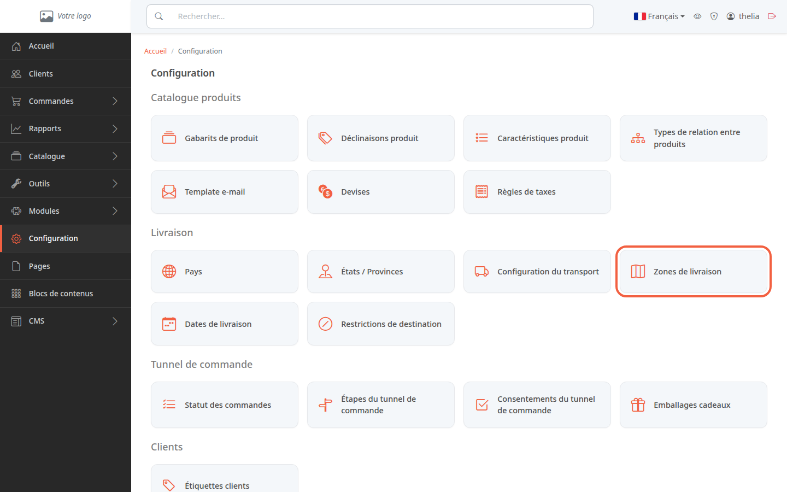
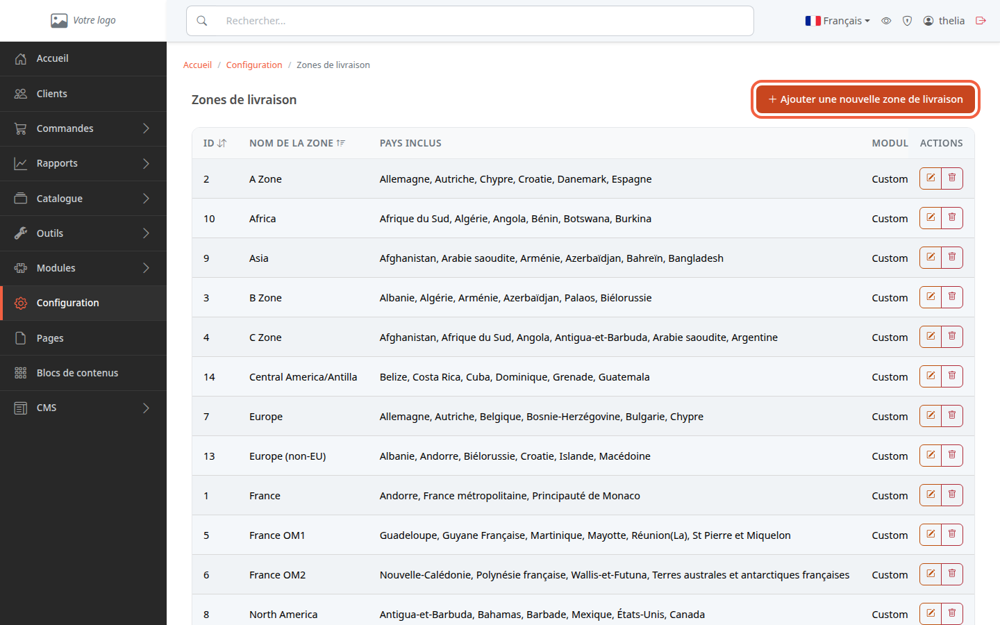
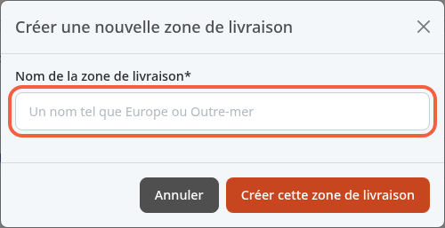
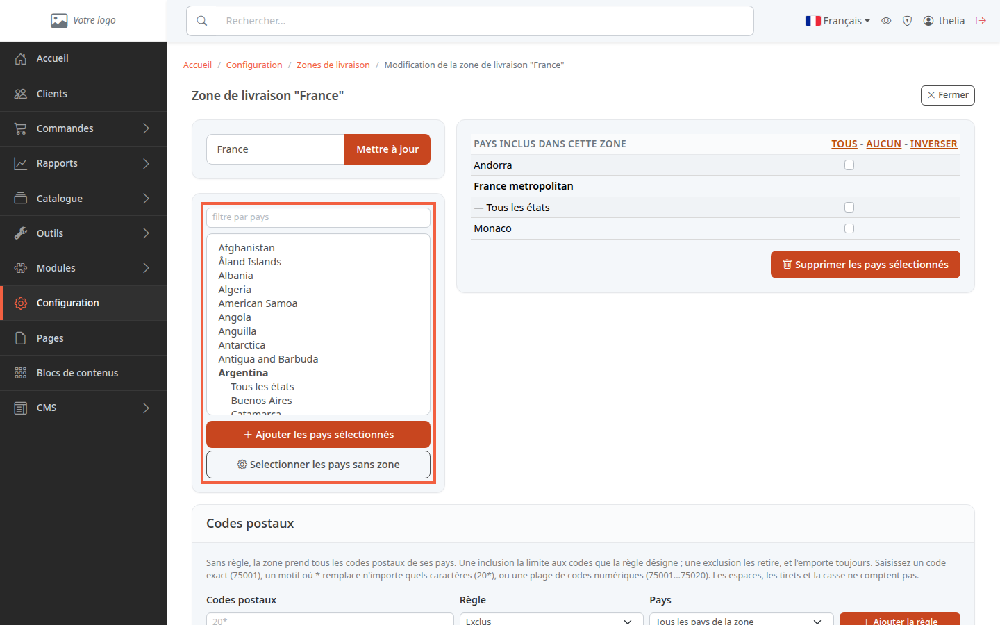
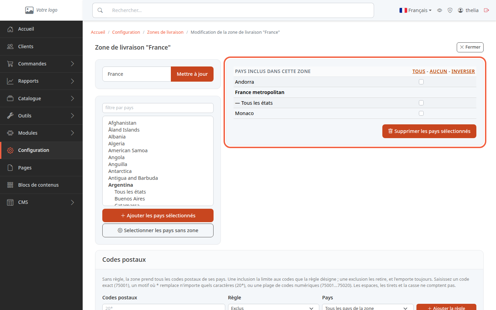

Une zone de livraison est un groupe de pays, par exemple « France » ou « Europe ». Vous créez vos zones une fois, puis vous indiquez pour chaque mode de livraison les zones où il livre : au moment de commander, le client ne voit que les modes de livraison dont une zone contient le pays de son adresse.

**Avant de commencer :** il vous faut un accès au back-office (voir [Découvrir le back-office](/getting-started/back-office-tour/)). La boutique de démonstration contient déjà des zones : vous pouvez les consulter sans rien modifier.

## Étape 1 : ouvrir les zones de livraison

1. Dans le menu de gauche, cliquez sur **Configuration**.
2. Dans la section **Livraison**, cliquez sur la carte **Zones de livraison**.

Ne la confondez pas avec la carte **Configuration du transport**, juste à côté : celle-ci sert à rattacher les zones aux modes de livraison (voir [Activer un mode de livraison](/payment-delivery/enable-delivery/)).

La page **Zones de livraison** liste les zones existantes, avec leurs pays et les modules de livraison qui y sont associés.

## Étape 2 : nommer la zone

1. Cliquez sur **Ajouter une nouvelle zone de livraison**.
2. Dans **Nom de la zone de livraison**, saisissez le nom de la zone, par exemple `Outre-mer`.
3. Cliquez sur **Créer cette zone de livraison**.

La page de la zone s'ouvre. Elle ne contient encore aucun pays.

## Étape 3 : ajouter des pays

La page de la zone a deux colonnes. À gauche, les pays que vous pouvez ajouter. À droite, **Pays inclus dans cette zone**. La capture montre la zone **France** de la démonstration.

1. Dans le champ **filtre par pays**, tapez le nom du pays. La liste se réduit.
2. Cliquez sur un pays. Pour en choisir plusieurs, maintenez la touche Ctrl (Cmd sur Mac) enfoncée en cliquant.
3. Cliquez sur **Ajouter les pays sélectionnés**.

Certains pays se déplient en états ou provinces (par exemple Argentina, avec **Tous les états** puis la liste des états). Sélectionnez **Tous les états** pour livrer le pays entier, ou un état seulement pour ne livrer que cette partie du pays.

Pour sélectionner d'un coup les pays qui ne sont dans aucune zone, cliquez sur **Selectionner les pays sans zone**, puis sur **Ajouter les pays sélectionnés**.

## Étape 4 : retirer un pays ou renommer la zone

Pour retirer des pays :

1. Dans la colonne de droite, cochez les pays à retirer. Les liens **Tous**, **Aucun** et **Inverser** cochent, décochent ou inversent toute la colonne.
2. Cliquez sur **Supprimer les pays sélectionnés**.

Pour renommer la zone :

1. Modifiez le nom dans le champ en haut à gauche, par exemple `DOM-TOM`.
2. Cliquez sur **Mettre à jour**.

## Le résultat

Les pays de la zone apparaissent dans la colonne de droite de la page de la zone, et dans la colonne **Pays inclus** de la liste. Il reste à rattacher la zone à un mode de livraison : une zone sans mode de livraison est signalée par un avertissement dans **Configuration du transport**.
