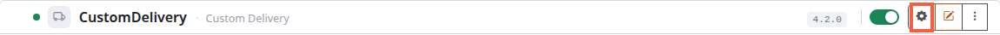
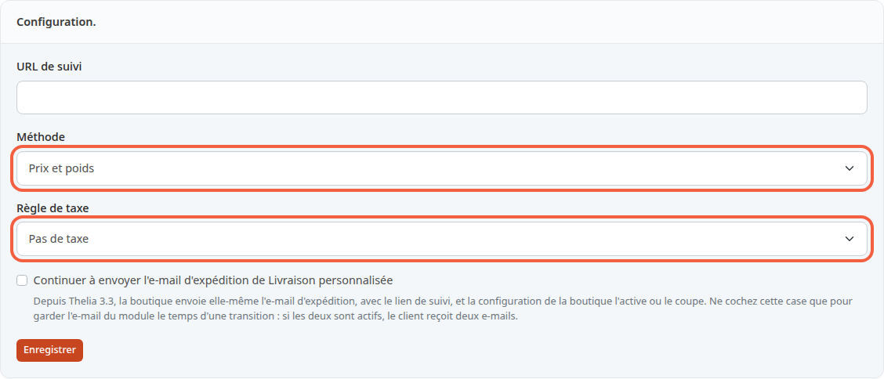
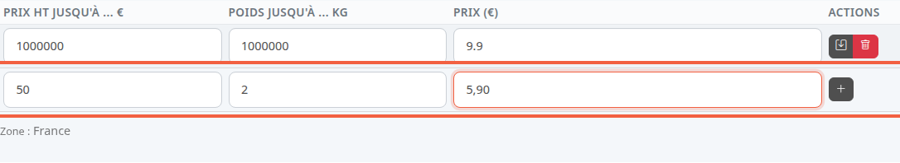

Avec le mode de livraison **CustomDelivery**, vous fixez vous-même le prix de la livraison. Il dépend du total du panier ou de son poids, et peut changer d'une zone à l'autre. Par exemple : 5,90 € jusqu'à 2 kg, 9,90 € jusqu'à 5 kg.

**Avant de commencer :** le module **CustomDelivery** doit être activé et rattaché à vos zones de livraison (voir [Activer un mode de livraison et lui associer des zones](/payment-delivery/enable-delivery/)). Sans zone rattachée, l'écran n'affiche aucun tableau de tranches.

## Étape 1 : ouvrir la configuration du module

1. Dans le menu à gauche, cliquez sur **Modules**, puis sur **Modules**.
2. Au-dessus de la liste, cliquez sur **Livraison**.
3. Sur la ligne **CustomDelivery**, cliquez sur l'engrenage (**Configurer ce module**).

L'écran **Configurer : CustomDelivery - Custom Delivery** contient deux blocs : **Configuration.** en haut, **Tranches.** en dessous.

## Étape 2 : choisir comment le tarif se calcule

1. Dans **Méthode**, choisissez ce qui fait varier le prix :
   - **Prix** : le total du panier ;
   - **Poids** : le poids des produits ;
   - **Prix et poids** : les deux à la fois (choix de départ).
2. Dans **Règle de taxe**, choisissez la règle de TVA appliquée aux frais de port. **Pas de taxe** est le choix de départ. Les règles se créent dans [Régler la TVA](/settings/tax-rules/).
3. Cliquez sur **Enregistrer**, sous le bloc.

Le champ **URL de suivi** et la case sur l'e-mail d'expédition ne servent pas aux tarifs : laissez-les tels quels.

Après l'enregistrement, le tableau des tranches s'adapte : la colonne **Poids jusqu'à ... kg** disparaît avec la méthode **Prix**, la colonne **Prix HT jusqu'à ... €** avec la méthode **Poids**.

## Étape 3 : ajouter des tranches

Chaque zone rattachée au module a son propre tableau, avec son nom sous le tableau (**Zone : France**). Une tranche dit : « jusqu'à telle limite, le prix de livraison est tel montant ».

1. Dans le tableau de la zone, repérez la ligne vide du bas.
2. Dans **Prix HT jusqu'à ... €**, saisissez le total maximal du panier hors taxes, par exemple `50`.
3. Dans **Poids jusqu'à ... kg**, saisissez le poids maximal, par exemple `2`.
4. Dans **Prix (€)**, saisissez le prix de la livraison hors taxes, par exemple `5,90`.
5. Cliquez sur le bouton **+** en fin de ligne.

La tranche s'ajoute au-dessus de la ligne vide, qui se vide pour la suivante. Seules les colonnes de votre méthode s'affichent : avec **Poids**, ne remplissez que le poids et le prix.

Pour changer une tranche, modifiez ses champs puis cliquez sur l'icône de disquette. Pour la supprimer, cliquez sur la corbeille : la tranche disparaît tout de suite, sans demande de confirmation.

- Écrivez les décimales avec une virgule : `5,90`. Un point est ignoré, et `5.90` devient 590.
- Les valeurs déjà enregistrées s'affichent avec un point (`9.9`). Avant d'enregistrer une ligne existante, retapez avec une virgule chaque valeur qui contient un point (`9,9`), sinon `9.9` devient 99.
- Une limite doit être supérieure à 0. Sinon une fenêtre **Message** affiche par exemple « La valeur du poids max n'est pas valide ».
- Un prix de `0` est accepté : la livraison est alors gratuite pour cette tranche.

## Étape 4 : comprendre quelle tranche s'applique

Quand le client choisit sa livraison, la boutique compare son panier aux tranches de la zone de son pays.

- Elle retient la plus petite tranche dont les limites sont **strictement** supérieures au panier. Avec une tranche « jusqu'à 50 € », un panier de 50,00 € passe dans la tranche suivante.
- Le total du panier est celui des produits hors taxes, une fois les remises déduites. Le poids est celui des produits multiplié par les quantités.
- Le poids d'un produit se saisit à sa création, dans **Poids (kg)** (voir [Créer un produit](/catalog/create-product/)), ou plus tard dans l'onglet **Combinaisons** de sa fiche, colonne **Poids** (voir [Fixer le prix, la TVA et le stock](/catalog/set-price-stock/)). Un produit sans poids compte pour 0 kg.
- Avec **Prix et poids**, la tranche doit convenir pour le prix et pour le poids.
- Si aucune tranche ne convient, **CustomDelivery n'est pas proposé** à ce client : il n'existe pas de tarif par défaut. Si vos tranches s'arrêtent à 5 kg, un panier de 8 kg n'a pas ce mode de livraison.
- Une zone sans tranche n'a pas non plus ce mode.

Dans la boutique de démonstration, chaque zone a une seule tranche très large (jusqu'à 1000000 € et 1000000 kg) à 9,90 € : la livraison y coûte 9,90 € quel que soit le panier.

## Le résultat

Chaque zone affiche ses tranches, de la plus petite à la plus grande. Au moment de la commande, le client dont le panier entre dans une tranche voit le mode **CustomDelivery** avec son prix.
