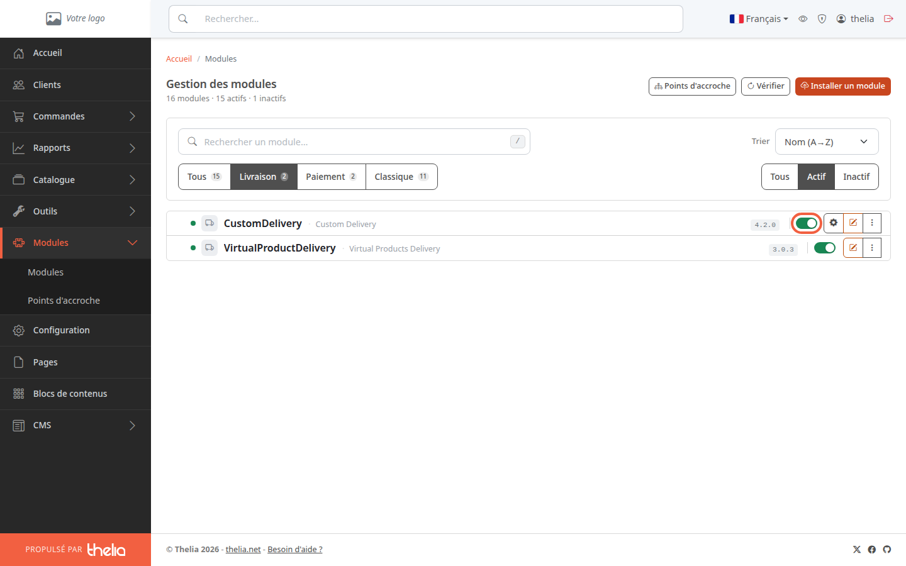
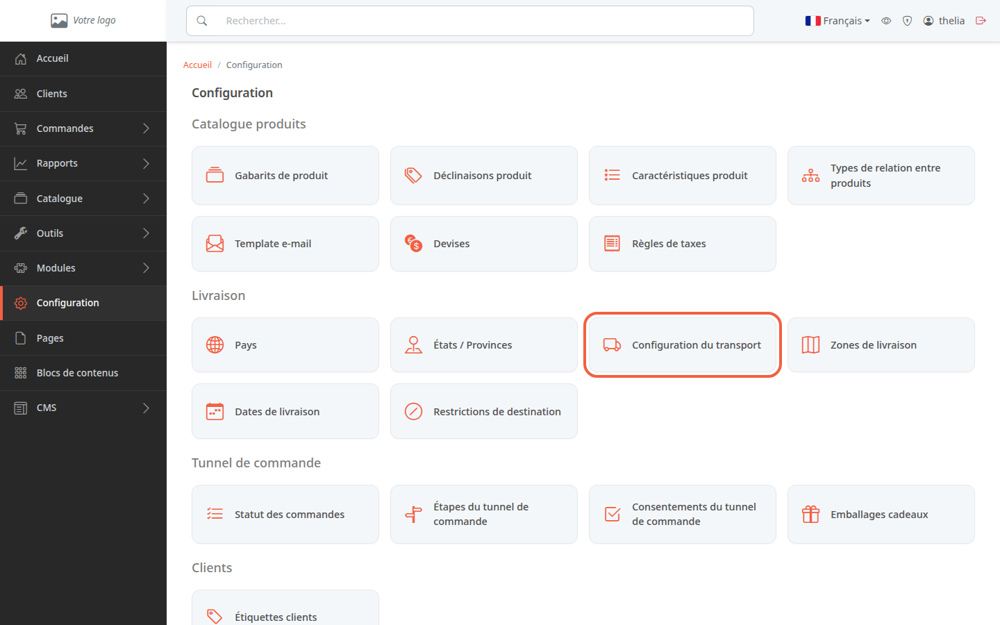
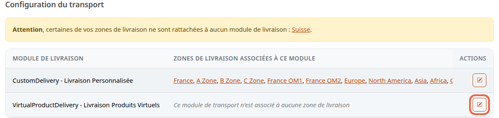
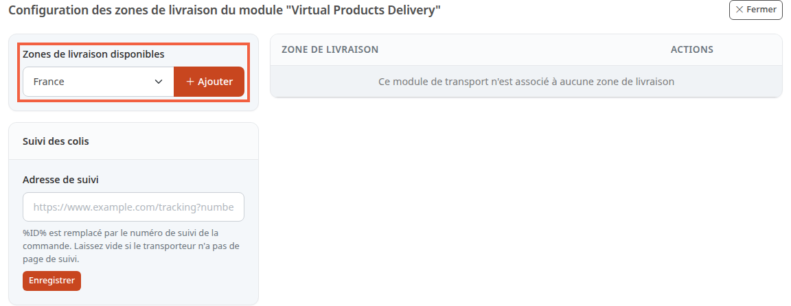
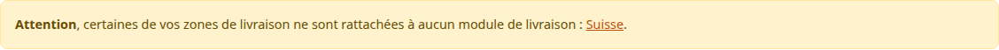

Un mode de livraison est la façon dont le client reçoit sa commande, par exemple la livraison à domicile. Pour qu'il apparaisse au moment de la commande, il doit être activé et rattaché aux zones où il livre.

**Avant de commencer :** il vous faut au moins une zone de livraison, c'est-à-dire un groupe de pays comme « France ». La boutique de démonstration en contient déjà ; pour créer les vôtres, suivez [Créer une zone de livraison](/payment-delivery/create-shipping-zone/).

## Étape 1 : vérifier que le mode de livraison est activé

Un mode de livraison est un module, un petit programme ajouté à la boutique. La boutique de démonstration en contient deux : **CustomDelivery** (livraison à tarifs que vous fixez) et **VirtualProductDelivery** (produits téléchargeables, sans configuration).

1. Dans le menu à gauche, cliquez sur **Modules**, puis sur **Modules**.
2. Au-dessus de la liste, cliquez sur **Livraison**.
3. Regardez l'interrupteur à droite de la ligne du module : vert, le module est activé.

Si l'interrupteur est gris, cliquez dessus pour activer le module. Il n'apparaît pas dans la liste ? Le filtre **Actif** est choisi par défaut : cliquez sur **Tous**, à droite, pour voir aussi les modules désactivés.

Un module désactivé n'est jamais proposé au client : la boutique ne cherche les modes de livraison que parmi les modules activés.

## Étape 2 : ouvrir la configuration du transport

1. Dans le menu à gauche, cliquez sur **Configuration**.
2. Dans le bloc **Livraison**, cliquez sur la carte **Configuration du transport**.

Ne la confondez pas avec la carte voisine **Zones de livraison** : celle-ci sert à créer les zones et à choisir leurs pays.

L'écran **Configuration du transport** liste chaque mode de livraison et, en face, les zones où il livre.

Un mode sans zone affiche « Ce module de transport n'est associé à aucune zone de livraison ». Sur la capture, un bandeau **Attention** apparaît au-dessus du tableau : il cite la zone **Suisse**, créée pour l'exemple, qui n'est rattachée à aucun mode de livraison. Il est expliqué à l'étape 4.

## Étape 3 : rattacher une zone au mode de livraison

1. Sur la ligne du mode de livraison, cliquez sur l'icône en forme de crayon.
2. Dans **Zones de livraison disponibles**, choisissez une zone, par exemple **France**.
3. Cliquez sur **Ajouter**.

La zone passe dans le tableau de droite. Répétez l'opération pour chaque zone, par exemple **Europe**. Quand toutes les zones sont rattachées, l'écran affiche à la place « Ce module livre dans toutes les zones de livraison ».

Pour retirer une zone, cliquez sur l'icône de corbeille de sa ligne, puis confirmez avec **Supprimer**.

La capture montre **VirtualProductDelivery**, seul module de la démonstration sans zone. Sur votre boutique, rattachez de la même façon les zones de **CustomDelivery**. Ce module doit ensuite recevoir ses tarifs : voir [Fixer ses tarifs de livraison par prix ou par poids](/payment-delivery/custom-delivery-rates/).

## Étape 4 : comprendre l'avertissement sur les zones non rattachées

Le bandeau apparaît quand au moins une zone n'est rattachée à aucun mode de livraison. Il dit « **Attention**, certaines de vos zones de livraison ne sont rattachées à aucun module de livraison : », suivi de la liste des zones concernées.

La zone **Suisse** de la capture n'a aucun pays : le bandeau la cite quand même, car il ne regarde que le rattachement aux modes de livraison.

Pour un client dont le pays n'appartient qu'à ces zones, aucun mode de livraison n'est proposé pour des produits physiques : la boutique ne propose un mode que si la zone du pays de livraison lui est rattachée. Pour corriger, rattachez la zone à un mode de livraison comme à l'étape 3. Le nom de la zone dans le bandeau ouvre l'écran de ses pays, pas celui du rattachement.

Le bandeau ne dit pas si le module est activé : une zone rattachée à un module désactivé ne le déclenche pas. Vérifiez donc aussi l'étape 1.

Le module **VirtualProductDelivery** n'a pas besoin de zone : pour un panier qui ne contient que des produits téléchargeables, la boutique ne vérifie pas les zones.

## Le résultat

Le mode de livraison est activé et chaque zone où vous livrez lui est rattachée : le tableau de **Configuration du transport** montre ses zones et le bandeau **Attention** ne cite plus ces zones. Vos clients des pays concernés peuvent alors le choisir à la commande.
