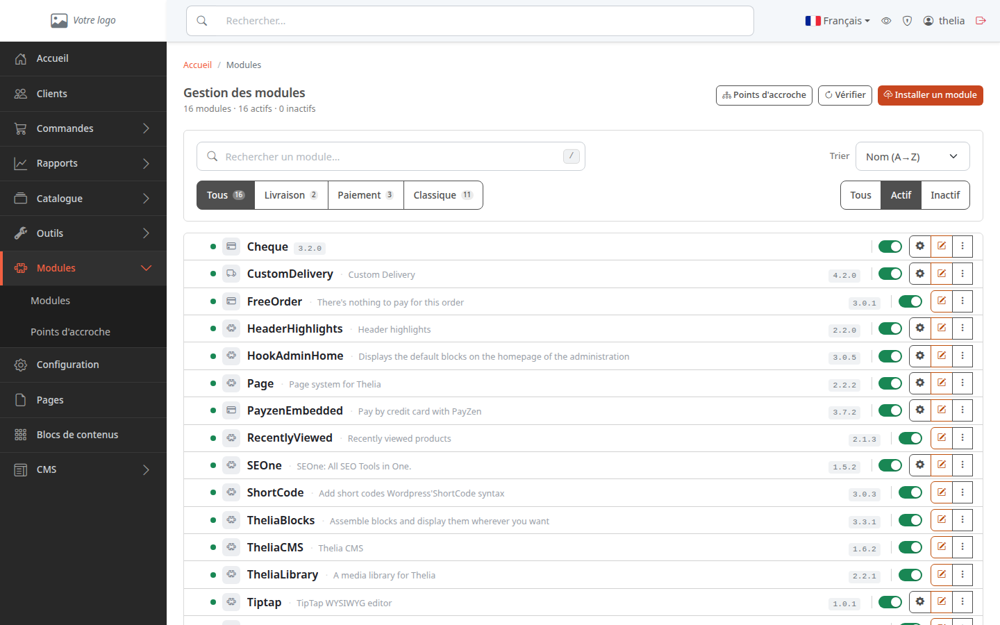
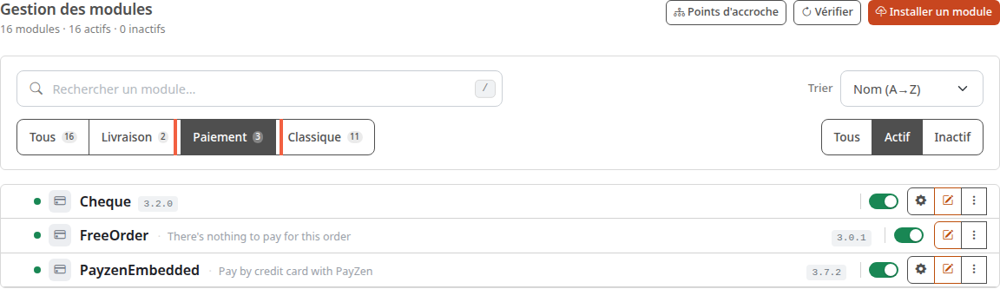
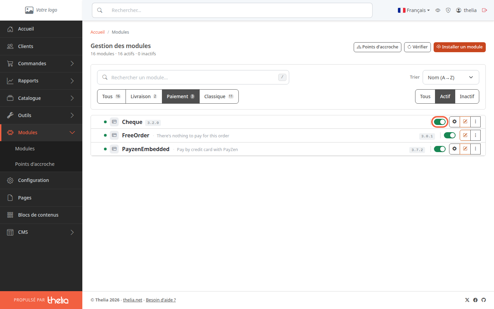
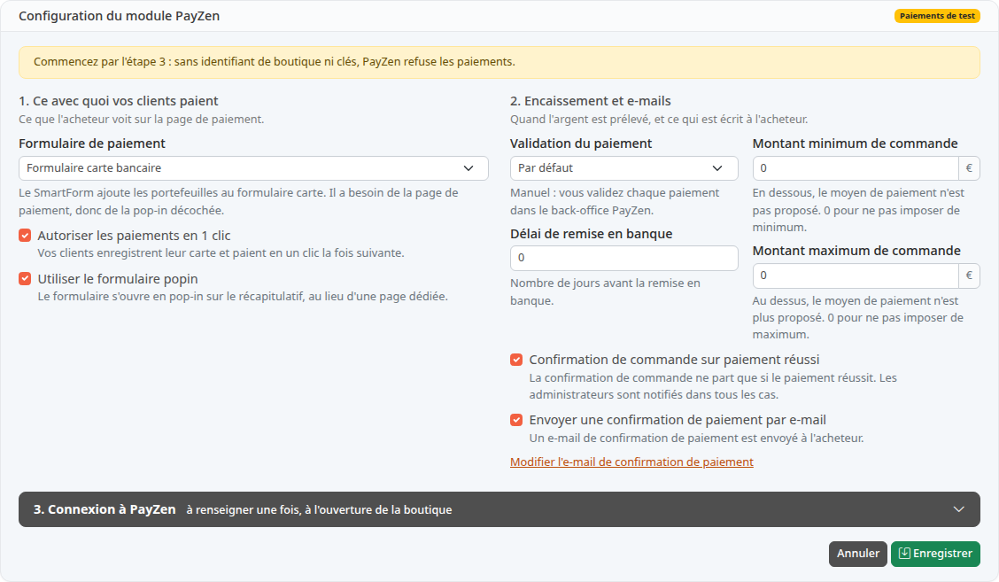

Un moyen de paiement est la façon dont vos clients règlent leur commande, par exemple le chèque ou la carte bancaire. Dans Thelia, chaque moyen de paiement est un module : il suffit d'activer ceux que vous voulez proposer.

**Avant de commencer :** il vous faut un accès au back-office (voir [Découvrir le back-office](/getting-started/back-office-tour/)) et les modules de paiement installés sur la boutique.

## Étape 1 : ouvrir la liste des modules

1. Dans le menu de gauche, cliquez sur **Modules**.
2. Dans le sous-menu, cliquez sur **Modules**.

La page **Gestion des modules** liste tous les modules de la boutique. Sous le titre, une ligne donne le total, par exemple « 16 modules · 16 actifs · 0 inactifs ».

## Étape 2 : afficher les moyens de paiement

Un module peut servir à autre chose qu'à payer : livrer, ajouter une fonction à la boutique. Pour ne voir que les moyens de paiement :

1. Cliquez sur **Paiement**, dans la rangée de boutons à gauche sous le champ de recherche.
2. Regardez la rangée de boutons à droite : **Actif** est sélectionné d'office. Les modules désactivés sont donc cachés. Cliquez sur **Tous** ou sur **Inactif** pour les voir.

Dans la boutique de démonstration, trois moyens de paiement sont installés :

- **Cheque** : le client paie par chèque. Ce moyen est proposé quand le total de la commande est supérieur à 0.
- **FreeOrder** : « Commande gratuite ». Il est proposé quand le total de la commande est exactement 0, par exemple après un code promo qui couvre tout. Il marque alors la commande comme payée, sans que le client ait à payer quoi que ce soit.
- **PayzenEmbedded** : paiement par carte bancaire, avec le prestataire de paiement PayZen. Il demande un compte chez ce prestataire. Il n'est proposé qu'une fois réglé (voir l'étape 4), et quand le total de la commande est compris entre les montants minimum et maximum réglés. Tant qu'il n'est pas en mode production, seuls les visiteurs dont l'adresse IP est autorisée dans ses réglages le voient.

## Étape 3 : activer ou désactiver un module

Chaque ligne a un interrupteur. Quand il est vert et allumé, comme sur la capture, le module est actif.

1. Repérez la ligne du moyen de paiement, par exemple **Cheque**.
2. Cliquez sur l'interrupteur à droite de la ligne.

La page se recharge et affiche de nouveau tous les modules actifs. Un module que vous venez de désactiver n'y figure donc plus : cliquez sur **Inactif** pour le retrouver.

Un module activé est proposé à vos clients au moment de payer, tant que sa condition est remplie (voir les trois modules ci-dessus). Pour le retirer, cliquez de nouveau sur l'interrupteur.

Un module qui n'a pas d'interrupteur modifiable est obligatoire : il ne peut pas être désactivé.

## Étape 4 : régler un moyen de paiement

Une roue crantée apparaît à droite de l'interrupteur des modules actifs qui ont des réglages (ici **Cheque** et **PayzenEmbedded**). **FreeOrder** n'en a pas : il n'y a rien à régler. Un module désactivé n'a pas de roue crantée : activez-le d'abord.

1. Cliquez sur la roue crantée, ou sur le nom du module.
2. Renseignez les champs de l'écran qui s'ouvre.

Pour la carte bancaire, l'écran **Configuration du module PayZen** s'ouvre. Il regroupe le formulaire de paiement, le moment de l'encaissement, les montants minimum et maximum de commande et les e-mails envoyés à l'acheteur.

Le badge **Paiements de test**, en haut à droite, indique que le module n'est pas encore en mode production.

Le bloc **3. Connexion à PayZen** demande l'identifiant de votre boutique et vos clés. Ils sont fournis par PayZen quand vous souscrivez un contrat : sans eux, l'écran affiche « Commencez par l'étape 3 : sans identifiant de boutique ni clés, PayZen refuse les paiements. »

## Le résultat

Le moyen de paiement apparaît dans la liste avec un interrupteur vert, et le compteur **actifs** en haut de page a augmenté d'une unité. Pensez ensuite à activer un mode de livraison : [Activer un mode de livraison](/payment-delivery/enable-delivery/).
