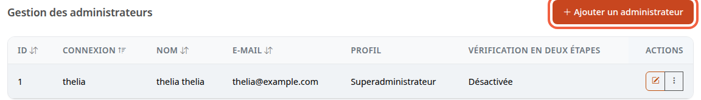
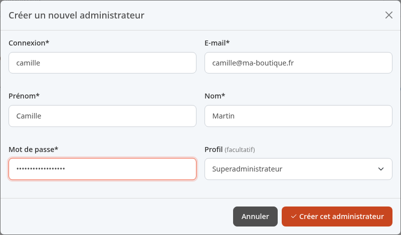

Chaque personne qui travaille dans la boutique doit avoir son propre compte administrateur : vous savez ainsi qui a fait quoi, et vous pouvez retirer un accès sans changer le mot de passe des autres. Ce tutoriel crée le compte de Camille Martin, une collaboratrice.

**Avant de commencer :** vous avez un compte administrateur autorisé à gérer les administrateurs. Ayez sous la main l'adresse e-mail de la personne.

## Étape 1 : ouvrir la liste des administrateurs

1. Dans le menu, cliquez sur **Configuration**.
2. Dans la section **Système**, cliquez sur **Administrateurs**.

Le tableau montre chaque compte : **Connexion** (l'identifiant), **Nom**, **E-mail**, **Profil** et **Vérification en deux étapes**. Cette dernière colonne indique si la personne a activé la double authentification.

## Étape 2 : remplir le formulaire

1. Cliquez sur **Ajouter un administrateur**.
2. Remplissez le formulaire **Créer un nouvel administrateur**.

Exemple :

- **Connexion** : `camille`. C'est l'identifiant qu'elle saisira pour se connecter (son e-mail fonctionne aussi).
- **E-mail** : `camille@ma-boutique.fr`.
- **Prénom** : `Camille`.
- **Nom** : `Martin`.
- **Mot de passe** : un mot de passe de départ. Thelia exige au moins 4 caractères, choisissez-en davantage.
- **Profil** : voir l'étape 3.

Tous les champs marqués d'une étoile sont obligatoires ; **Profil** est facultatif. La **Connexion** et l'**E-mail** ne doivent pas déjà servir à un autre administrateur : sinon, Thelia refuse la création.

## Étape 3 : choisir le profil

Le **Profil** décide à quelles parties du back-office la personne a accès.

- Laissé sur **Superadministrateur**, le compte a tous les droits.
- Un autre profil de la liste limite le compte aux droits de ce profil.

Seul un superadministrateur peut donner le profil **Superadministrateur**.

Dans la démo, aucun profil n'existe encore : la liste ne propose que **Superadministrateur**. Une boutique réelle crée ses profils (par exemple un profil limité aux commandes) avant d'ajouter ses collaborateurs. Ne laissez pas **Superadministrateur** à quelqu'un qui n'en a pas besoin.

## Étape 4 : enregistrer et prévenir la personne

1. Cliquez sur **Créer cet administrateur**.
2. Transmettez à Camille son identifiant et son mot de passe de départ par un canal sûr, pas dans un message ouvert à tous.

Elle se connecte comme décrit dans [Découvrir le back-office](/getting-started/back-office-tour/).

Si votre boutique impose la double authentification, Camille est dirigée vers l'écran de mise en place à sa première visite du back-office, tant qu'elle ne l'a pas activée. Guidez-la avec [Activer la double authentification de son compte](/getting-started/two-factor/).

## Le résultat

Camille apparaît dans le tableau, avec son profil. La colonne **Vérification en deux étapes** affiche **Désactivée**, puis **Activée** quand elle a mis en place la double authentification. Pour supprimer ou modifier un compte plus tard, utilisez les boutons de sa ligne dans la colonne **Actions**.
