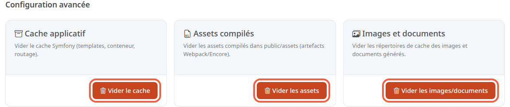

Le cache est une copie de pages et de fichiers que la boutique garde de côté pour s'afficher plus vite. Quand vous changez quelque chose, il arrive que l'ancienne copie reste affichée : vider le cache la supprime, et la boutique la refait à la demande.

**Avant de commencer :** il vous faut un compte administrateur.

## Étape 1 : ouvrir la page

1. Dans le menu à gauche, cliquez sur **Configuration**.
2. Dans le groupe **Système**, cliquez sur **Configuration avancée**.

La page propose trois cartes, chacune avec son bouton.

## Étape 2 : choisir le bon bouton

- **Vider le cache** (carte **Cache applicatif**) : supprime le répertoire de cache de l'application. Le texte de la carte précise : templates, conteneur, routage. Une fenêtre de confirmation prévient que les pages suivantes se chargent plus lentement le temps que le cache se reconstruise.
- **Vider les assets** (carte **Assets compilés**) : supprime les fichiers du dossier `public/assets` de la boutique. La fenêtre de confirmation le dit : **Vider les assets compilés ? Les fichiers de public/assets sont supprimés.**
- **Vider les images/documents** (carte **Images et documents**) : supprime les copies d'images et de documents déjà générées, par défaut dans `public/cache/images` et `public/cache/documents`. Les fichiers d'origine sont conservés, comme le dit la fenêtre de confirmation. Les copies sont refaites à l'affichage suivant.

N'utilisez **Vider les assets** que si la personne qui s'occupe de votre site vous le demande.

Sur une boutique en production (le site ouvert à vos clients) dont les styles et les scripts ont été préparés à la mise en ligne, ce dossier les contient pour la boutique et le back-office. Ils ne se recréent pas seuls : le site et le back-office peuvent s'afficher sans leur mise en forme tant qu'ils ne sont pas préparés à nouveau.

## Étape 3 : vider

1. Cliquez sur le bouton choisi.
2. Dans la fenêtre de confirmation, cliquez sur le bouton portant le même libellé.

Au retour sur la page, un message indique le résultat. Il s'affiche en anglais : **Application cache cleared.**, **Web assets cache cleared.** ou **Images and documents cache cleared.** Un message d'erreur apparaît à la place si le vidage échoue.

## Quand s'en servir

Quand une modification du thème faite par la personne qui s'occupe de votre site n'apparaît pas, essayez d'abord **Vider le cache**. Pour une image ou un document qui ne se met pas à jour, essayez **Vider les images/documents**. Ce bouton ne touche pas aux vignettes du dossier `public/media/cache`, comme celles des cartes produit de la boutique. Dans les deux cas, rechargez ensuite la page de la boutique dans votre navigateur.

Ne videz pas à chaque modification : après un vidage, les pages sont plus lentes tant que le cache n'est pas reconstruit.

## Le résultat

Vous savez quel bouton vide quoi, et lequel essayer en premier. Après un vidage, le message de confirmation s'affiche en haut de la page. Le cache et les copies d'images se reconstruisent au fil des visites.
