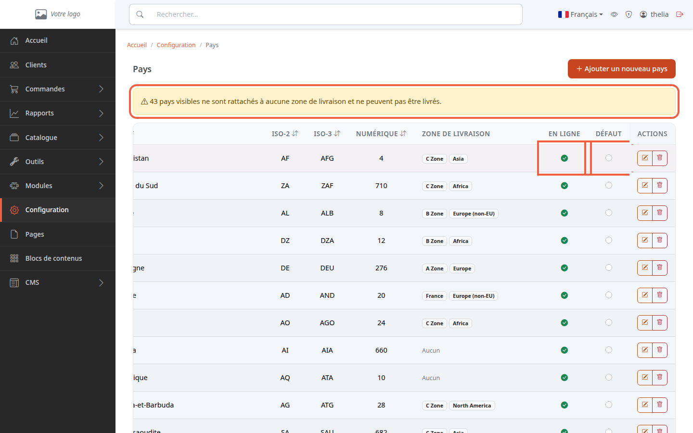
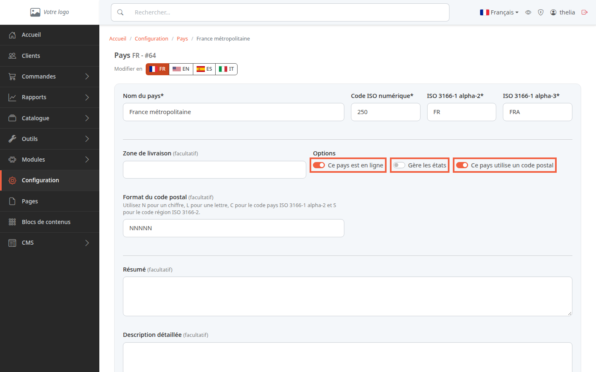

Cette page liste les pays connus de la boutique. Vous y décidez lesquels sont proposés aux clients, par exemple pour une adresse de livraison, et quel pays sert de pays par défaut.

**Avant de commencer :** il vous faut un compte administrateur. Rien dans ce tutoriel n'oblige à enregistrer : vous pouvez tout consulter sans rien modifier.

## Étape 1 : ouvrir la liste des pays

1. Dans le menu à gauche, cliquez sur **Configuration**.
2. Dans la partie **Livraison**, cliquez sur **Pays**.

La liste donne le **Pays**, ses codes **ISO-2**, **ISO-3** et **Numérique** (les codes officiels du pays), sa **Zone de livraison** et deux réglages : **En ligne** et **Défaut**. Le tableau est plus large que l'écran : pour voir les colonnes **En ligne** et **Défaut**, faites-le défiler vers la droite, par exemple avec la molette de la souris en tenant la touche Maj.

Une bannière jaune apparaît s'il existe des pays en ligne sans zone de livraison : « pays visibles ne sont rattachés à aucune zone de livraison et ne peuvent pas être livrés ».

## Étape 2 : comprendre ce que veut dire « En ligne »

**En ligne** correspond à la case **Ce pays est en ligne** de la fiche du pays. Un pays en ligne apparaît dans la liste des pays que le client choisit quand il saisit une adresse (compte client ou commande sans compte). Un pays hors ligne n'y apparaît pas : le client ne peut pas le choisir pour une adresse.

Mettre un pays en ligne ne suffit pas pour le livrer : comme le dit la bannière jaune, un pays rattaché à aucune zone de livraison ne peut pas être livré. Seule une commande qui ne contient que des produits virtuels (par exemple un fichier à télécharger) n'a pas besoin de zone. Pour rattacher un pays à une zone, voir [Créer une zone de livraison](/payment-delivery/create-shipping-zone/).

## Étape 3 : ouvrir la fiche d'un pays

1. Sur la ligne du pays, par exemple **France métropolitaine**, cliquez sur le bouton en forme de crayon.
2. Lisez les réglages de la rubrique **Options**.

- **Ce pays est en ligne** : voir l'étape 2.
- **Gère les états** : le pays a des États ou des provinces à choisir dans l'adresse.
- **Ce pays utilise un code postal** : le code postal saisi dans l'adresse est contrôlé selon le **Format du code postal** (N pour un chiffre, L pour une lettre, par exemple NNNNN pour cinq chiffres).

Cliquez sur **Annuler** pour quitter sans rien changer.

## Étape 4 : comprendre le pays par défaut

La colonne **Défaut** désigne le pays par défaut. Un seul pays l'est à la fois. Il sert de pays de référence quand la boutique ne sait pas encore où se trouve le client, par exemple pour calculer les taxes d'un visiteur sans compte (voir [Régler la TVA](/settings/tax-rules/)). Cliquer sur le bouton rond d'un autre pays en fait le nouveau pays par défaut.

## Le résultat

Vous savez lire la liste des pays, ce que signifie **En ligne** et où se règle le pays par défaut. Si un pays en ligne est signalé sans zone, rattachez-le à une zone de livraison.
