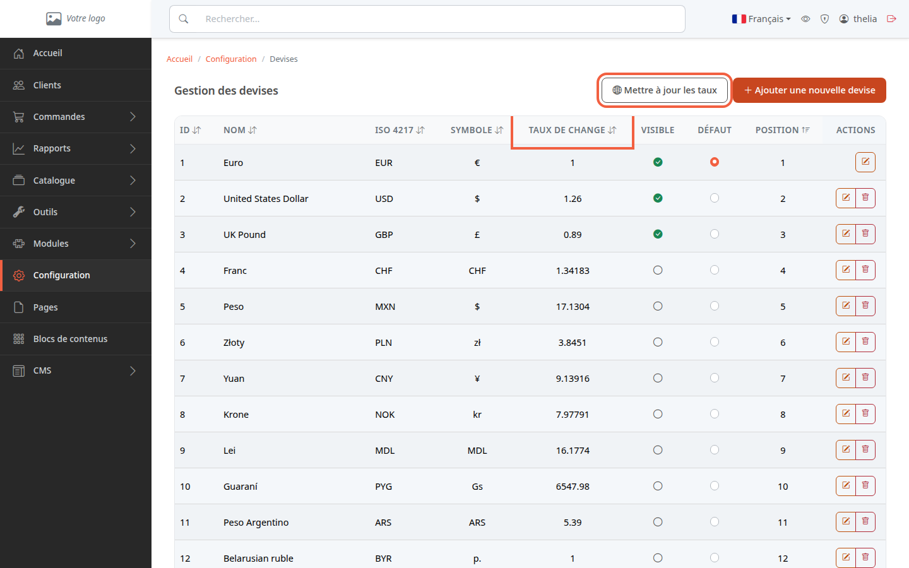
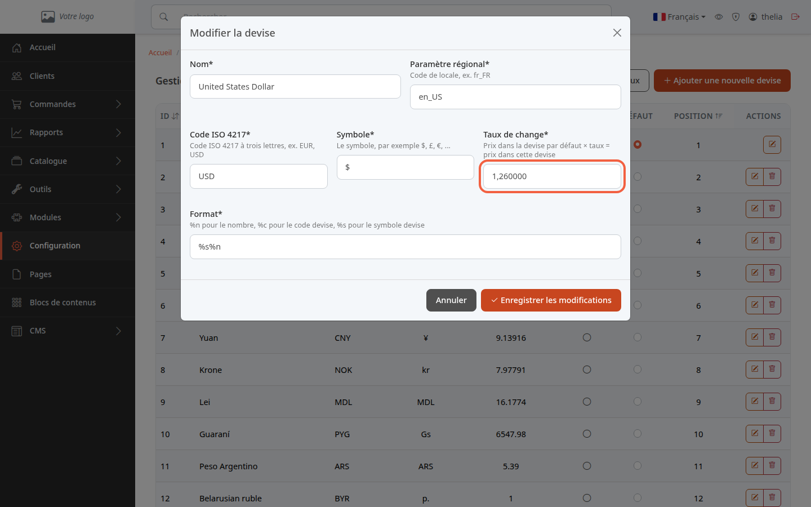

Une devise est la monnaie dans laquelle vos prix s'affichent, par exemple l'euro ou le dollar. Pour afficher aussi vos prix en dollars, il suffit que la devise **United States Dollar** soit **Visible** : vos clients peuvent alors choisir de voir les prix dans cette monnaie.

**Avant de commencer :** il vous faut un compte administrateur. Vous saisissez vos prix dans une seule devise, la devise par défaut ; les autres sont calculées.

## Étape 1 : ouvrir la liste des devises

1. Dans le menu à gauche, cliquez sur **Configuration**.
2. Dans la partie **Catalogue produits**, cliquez sur **Devises**.

La page **Gestion des devises** liste toutes les devises connues de la boutique. Chaque ligne indique le **Nom**, le code **ISO 4217** (trois lettres, par exemple EUR ou USD), le **Symbole** et le **Taux de change**.

## Étape 2 : comprendre le taux de change

Le taux de change dit combien vaut une unité de la devise par défaut dans cette devise. Avec l'euro par défaut et un taux de 1,26 pour le dollar, un produit à 10 euros s'affiche 12,60 dollars. La devise par défaut a un taux de 1, que **Mettre à jour les taux** remet à 1.

Les prix des produits ne sont pas à ressaisir : chaque prix est calculé en multipliant le prix de la devise par défaut par le taux. Seule exception, un prix saisi à la main sur le produit pour cette devise : il est alors utilisé tel quel.

Pour voir ou corriger un taux :

1. Sur la ligne de la devise, par exemple **United States Dollar**, cliquez sur le bouton en forme de crayon.
2. Lisez le champ **Taux de change**, dont l'aide rappelle la règle : prix dans la devise par défaut × taux = prix dans cette devise.

La fiche contient aussi le **Nom**, le **Paramètre régional** (code de langue, par exemple fr_FR), le **Code ISO 4217**, le **Symbole** et le **Format**. Dans **Format**, **%n** est le nombre, **%s** le symbole et **%c** le code : **%n %s** affiche « 12,60 $ », **%s%n** affiche « $12,60 ».

Cliquez sur **Annuler** pour fermer la fiche sans rien changer.

## Étape 3 : mettre les taux à jour

Les taux ne se mettent pas à jour tout seuls. Le bouton **Mettre à jour les taux**, en haut de la liste, va chercher les taux du jour pour toutes les devises, sauf la devise par défaut. Les taux viennent du fichier quotidien de la Banque centrale européenne.

1. Cliquez sur **Mettre à jour les taux**.
2. Si un message indique **Aucun taux de change n'a pu être récupéré pour :** suivi d'une liste de devises, par exemple « Lei (MDL) », ces devises n'ont pas de taux publié : leur taux n'a pas changé, corrigez-le à la main.

Attention : cette mise à jour écrase chaque taux qu'elle récupère, y compris ceux que vous avez saisis à la main. Une mise à jour automatique existe, mais elle est désactivée par défaut ; elle se règle côté hébergement, auprès de la personne qui gère votre serveur.

## Étape 4 : choisir ce que les clients voient

Dans la liste, deux colonnes décident du rôle de chaque devise.

- **Visible** : la devise est proposée aux clients. Une devise non visible reste dans la liste mais n'est pas proposée.
- **Défaut** : la devise dans laquelle vous saisissez vos prix. Un clic sur le bouton rond d'une autre ligne change la devise par défaut et lance aussitôt une mise à jour de tous les taux. Cette devise est aussi rendue visible. Attention : ce changement ne convertit pas les prix déjà saisis, qui restent enregistrés dans l'ancienne devise.

La devise par défaut ne peut pas être masquée ni supprimée. Pour supprimer une autre devise, utilisez le bouton corbeille de sa ligne.

Dans la boutique, le client voit un sélecteur de devise dans l'en-tête, par exemple « € EUR ». Il n'apparaît que si au moins deux devises sont **Visible**. Choisir une devise convertit les prix affichés.

## Le résultat

Vous savez quelles devises la boutique propose, comment se calcule un prix converti et comment rafraîchir les taux. Pour régler le prix d'un produit, voir [Fixer le prix, la TVA et le stock d'un produit](/catalog/set-price-stock/).
