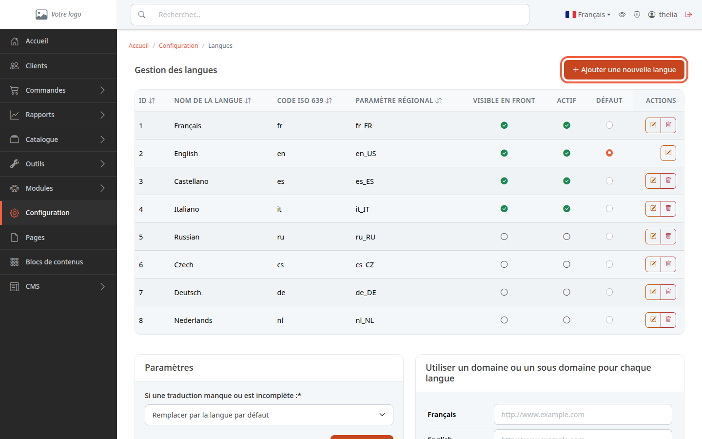
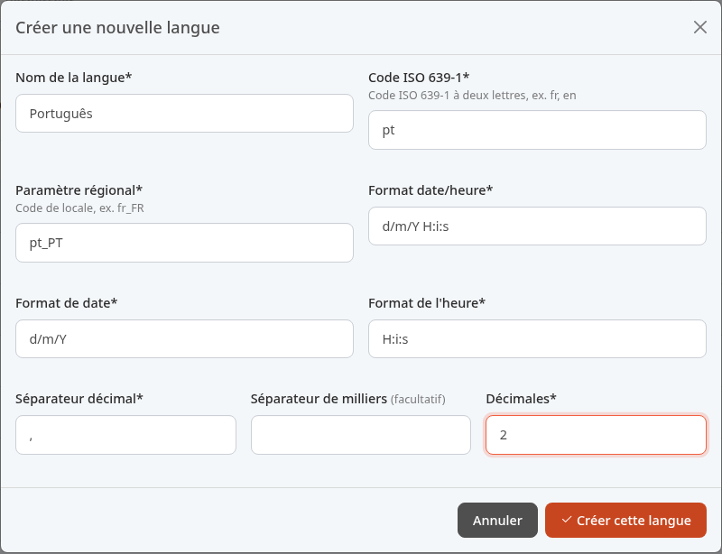
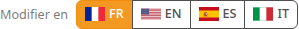
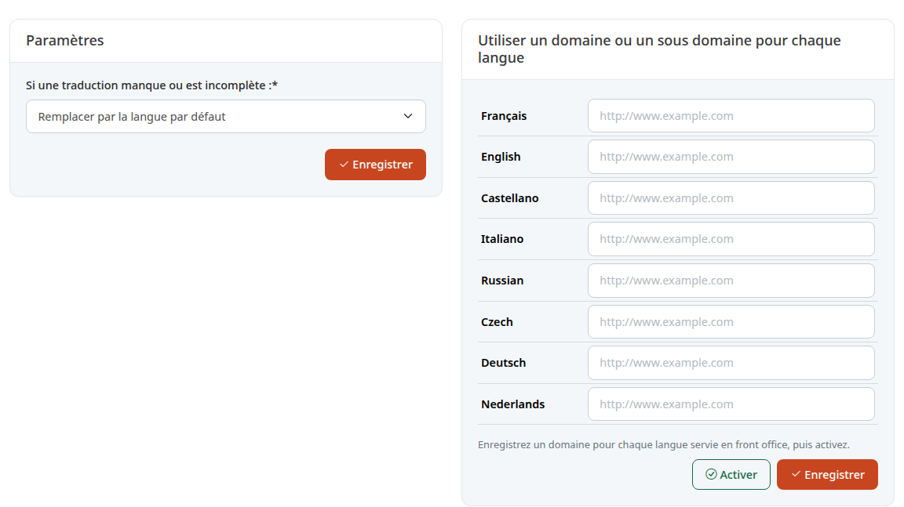

Vendre en plusieurs langues, par exemple en français et en anglais, permet d'accueillir des clients d'autres pays. Ce tutoriel vous montre comment ajouter une langue, la rendre disponible sur le site et ce qu'il reste à traduire ensuite.

**Avant de commencer :** il vous faut un compte administrateur. Prévoyez aussi les textes de votre boutique dans la nouvelle langue (produits, rubriques, pages).

## Étape 1 : ouvrir la liste des langues

1. Dans le menu, cliquez sur **Configuration**.
2. Dans la section **Système**, cliquez sur **Langues et URLs**.

Le tableau liste les langues connues de la boutique. Trois colonnes décident de leur rôle :

- **Visible en front** : la langue est présentée aux visiteurs de la boutique.
- **Actif** : la langue est utilisable.
- **Défaut** : la langue de référence de la boutique. Une seule langue l'est.

Dans la démo, le français, l'anglais, l'espagnol et l'italien sont actifs, et l'anglais est la langue par défaut. Les autres langues de la liste existent déjà mais restent éteintes : si la vôtre y figure (par exemple **Deutsch**), vous n'avez pas besoin de la créer, il suffit de l'activer à l'étape 3.

## Étape 2 : créer une langue absente de la liste

1. Cliquez sur **Ajouter une nouvelle langue**.
2. Remplissez le formulaire **Créer une nouvelle langue**.

Exemple pour le portugais :

- **Nom de la langue** : `Português`.
- **Code ISO 639-1** : `pt` (deux lettres).
- **Paramètre régional** : `pt_PT`.
- **Format date/heure** : `d/m/Y H:i:s`.
- **Format de date** : `d/m/Y`.
- **Format de l'heure** : `H:i:s`.
- **Séparateur décimal** : `,`.
- **Séparateur de milliers** : une espace (facultatif).
- **Décimales** : `2`.

Ces valeurs sont celles du français de la démo (jour/mois/année, puis heures:minutes:secondes). Pour une autre langue, adaptez l'ordre et les séparateurs : l'anglais de la démo utilise `m-d-Y` et un point décimal. Ils servent à afficher les dates et les nombres dans cette langue.

3. Cliquez sur **Créer cette langue**.

Une langue créée est **éteinte** : ni **Actif** ni **Visible en front** ne sont cochés au départ.

## Étape 3 : activer la langue

Dans la ligne de la langue, cliquez sur la pastille de la colonne voulue. Le changement s'applique tout de suite, sans bouton à valider.

1. Cliquez sur la pastille **Visible en front** pour la proposer aux visiteurs. Thelia coche alors aussi **Actif** si besoin.
2. Pour la retirer, décochez **Actif** : **Visible en front** se décoche en même temps.

Ce que chaque case change :

- **Actif** : la langue apparaît dans le sélecteur de langue du site (si la boutique a au moins deux langues actives) et dans les langues d'édition du back-office (étape 4). Une langue inactive n'est pas acceptée quand un visiteur la demande dans l'adresse (`?lang=`).
- **Visible en front** : la langue est marquée comme publique. Elle compte pour la liste des versions de langue du plan de site, quand le module correspondant est actif, et pour le choix de la langue selon le domaine (carte de l'étape 5). Sur le thème Flexy de la démo, le sélecteur de langue du site suit la case **Actif**, pas celle-ci.
- **Défaut** : cliquer sur la pastille d'une autre langue en fait la langue par défaut, et la coche **Actif** et **Visible en front**. C'est la langue servie à un visiteur qui n'a rien choisi.

Une erreur courante : la langue par défaut ne peut être ni désactivée, ni masquée, ni supprimée. Pour retirer l'anglais de la démo, choisissez d'abord une autre langue par défaut.

À la création de la langue, puis quand vous cochez **Actif**, Thelia ajoute les traductions livrées avec lui pour ce paramètre régional, s'il en existe (par exemple les noms de pays, les statuts de commande et l'objet des e-mails).

## Étape 4 : traduire vos produits et vos contenus

Activer une langue ne traduit rien : vos produits, rubriques et pages restent dans leur langue d'origine. Chaque fiche porte un sélecteur de langue d'édition, **Modifier en**, qui liste les langues actives.

1. Ouvrez la fiche, par exemple un produit.
2. Cliquez sur le drapeau de la langue à remplir.
3. Saisissez le titre et les descriptions dans cette langue, puis enregistrez.

Répétez pour chaque langue. Le sélecteur n'apparaît que s'il y a au moins deux langues actives.

## Étape 5 : choisir quoi afficher quand une traduction manque

Sous le tableau, la carte **Paramètres** règle le cas d'un texte non traduit.

Dans **Si une traduction manque ou est incomplète :**, deux choix existent :

- **Remplacer par la langue par défaut** : le texte de la langue par défaut prend la place. C'est le réglage de la démo.
- **Utiliser strictement la langue demandée** : rien n'est remplacé.

Cliquez sur **Enregistrer** de cette carte pour valider le choix.

À droite, la carte **Utiliser un domaine ou un sous domaine pour chaque langue** sert à donner une adresse par langue, par exemple `fr.ma-boutique.fr`. Remplissez une adresse pour chaque langue servie, cliquez sur **Enregistrer**, puis sur **Activer**. Thelia refuse d'activer ce réglage tant qu'une langue servie n'a pas d'adresse. Laissez cette carte vide si toutes vos langues partagent la même adresse.

## Le résultat

La langue figure dans le tableau avec ses cases cochées, et les visiteurs peuvent la choisir dans le sélecteur de langue du site. Elle apparaît dans le sélecteur **Modifier en** de chaque produit, rubrique ou page.
