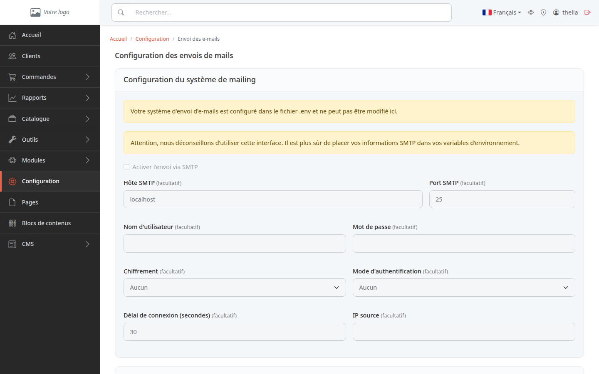
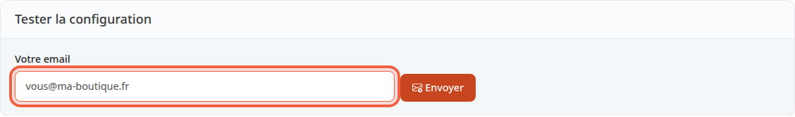

Votre boutique envoie des e-mails à vos clients, par exemple pour confirmer une commande. Ce tutoriel vous montre comment envoyer un e-mail de test à votre propre adresse, pour savoir si l'envoi fonctionne avant qu'un client ne l'attende.

**Avant de commencer :** il vous faut un compte administrateur et l'adresse e-mail de votre boutique renseignée dans les informations de la boutique. Elle sert d'expéditeur au message de test.

## Étape 1 : ouvrir la page

1. Dans le menu à gauche, cliquez sur **Configuration**.
2. Dans le groupe **Système**, cliquez sur **Envoi des e-mails**.

En haut de la page, un bloc **Configuration du système de mailing** liste les réglages d'envoi : hôte, port, identifiant, mot de passe, chiffrement. Vous n'avez rien à y modifier pour faire le test.

Si le message **Votre système d'envoi d'e-mails est configuré dans le fichier .env et ne peut pas être modifié ici.** s'affiche, le formulaire est grisé : ces réglages relèvent de la personne qui héberge votre site.

Sans ce message, le formulaire est modifiable. La page affiche pourtant toujours l'avertissement **Attention, nous déconseillons d'utiliser cette interface.** Laissez le formulaire tel quel et demandez à la personne qui héberge votre site de régler l'envoi.

## Étape 2 : envoyer l'e-mail de test

1. Faites défiler la page jusqu'au bloc **Tester la configuration**.
2. Le champ **Votre email** contient déjà l'adresse e-mail de votre boutique. Remplacez-la par l'adresse où vous voulez recevoir le test, par exemple `vous@ma-boutique.fr`.
3. Cliquez sur **Envoyer**.

Un seul clic suffit : le message part tout de suite, il n'y a pas d'étape de confirmation. Dix tests au plus sont acceptés en dix minutes par administrateur. Au-delà, la page répond **Trop de mails de test en peu de temps : attendez quelques minutes avant le suivant.**

## Étape 3 : lire la réponse

Le résultat s'affiche à droite du bouton, sans quitter la page.

- Envoi réussi, en vert : **Votre configuration semble correcte. Vérifiez votre boîte de réception : vous@ma-boutique.fr**. Le message reçu porte l'objet **E-mail de test depuis : Nom de votre boutique**.
- Adresse de la boutique absente, en rouge : **Vous devez d'abord configurer l'adresse e-mail de votre boutique !** Renseignez-la dans les informations de la boutique, puis recommencez.
- Champ vide : la page affiche **Please enter an email** (message resté en anglais).
- Adresse mal formée, en rouge : un message en anglais reprend l'adresse saisie, par exemple `Email "vous@" does not comply with addr-spec of RFC 2822.` Corrigez l'adresse, puis recommencez.
- Envoi refusé, en rouge : la page affiche la réponse du serveur de messagerie, ou **Le mail de test n'a pas pu être envoyé. Le détail est dans le journal du serveur.** Transmettez ce texte à la personne qui héberge votre site.

Le message vert veut seulement dire que l'envoi n'a pas été refusé. Ouvrez ensuite la boîte de réception de l'adresse saisie : si le message n'y est pas, regardez aussi dans les indésirables. S'il n'arrive toujours pas, signalez-le à la personne qui héberge votre site : l'envoi peut être réglé pour ne rien expédier, par exemple sur un site de test.

## Le résultat

Vous savez si votre boutique peut envoyer des e-mails. Un message vert et un e-mail reçu confirment que l'envoi fonctionne. Sinon, vous avez un texte précis à transmettre à la personne qui héberge votre site.
