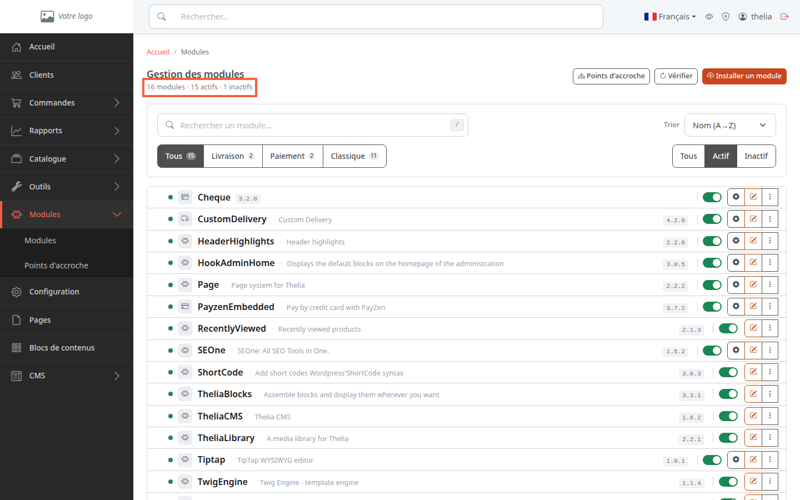
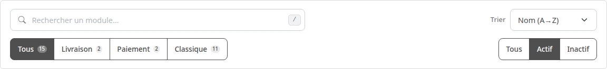
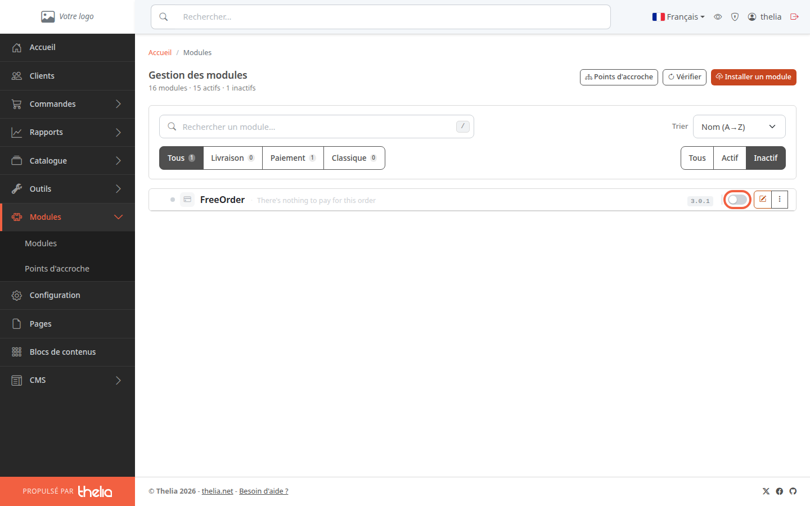
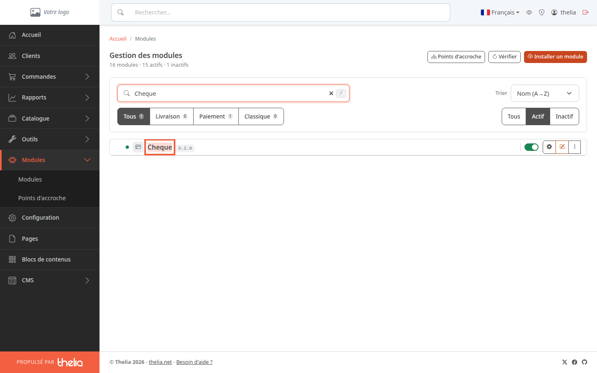
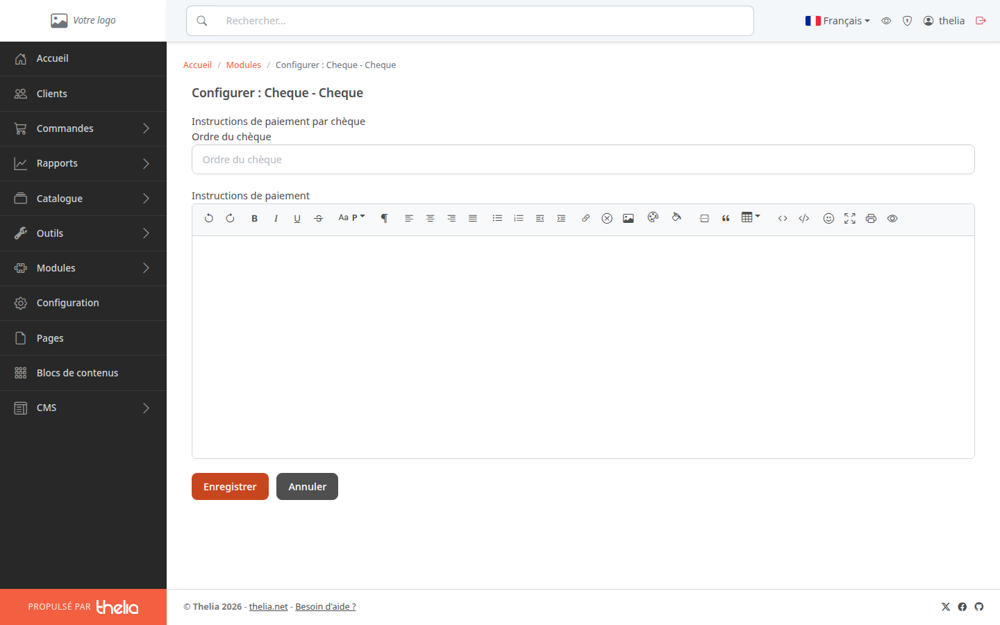
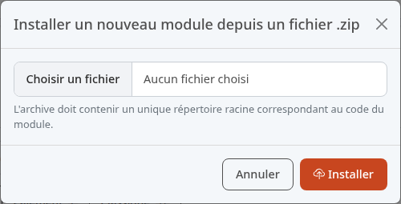

Un module est une extension qui ajoute une fonction à votre boutique, par exemple un moyen de paiement ou un transporteur. Cette page vous montre comment lire la liste des modules, en activer ou en désactiver un, et installer un nouveau module.

**Avant de commencer :** il vous faut un compte administrateur. Pour savoir comment entrer dans le back-office, voir [Découvrir le back-office](/getting-started/back-office-tour/).

## Étape 1 : lire la liste des modules

1. Dans le menu, cliquez sur **Modules**.
2. Dans le sous-menu, cliquez sur **Modules**.

Sous le titre **Gestion des modules**, une ligne résume le nombre de modules : le total, les actifs et les inactifs. Sur le bac de démonstration, elle affiche « 16 modules · 15 actifs · 1 inactifs » : la faute d'accord est celle de l'écran.

Chaque ligne de la liste montre :

- une pastille verte (module actif) ou grise (module inactif) ;
- le nom du module, son titre quand il diffère du nom, et son numéro de version ;
- un interrupteur pour l'activer ou le désactiver ;
- à droite, des boutons d'action : l'engrenage (configurer), le crayon (modifier les informations du module) et les trois points (autres actions).

## Étape 2 : filtrer la liste

La liste ne montre au départ que les modules actifs. Pour voir les autres, utilisez la barre au-dessus de la liste.

- **Rechercher un module…** : tapez une partie du nom, du titre ou de la version.
- **Trier** : **Nom (A→Z)**, **Plus récents** ou **Etat**.
- **Tous**, **Livraison**, **Paiement**, **Classique** : le type du module. Un module de paiement permet de régler une commande, un module de livraison propose un mode de livraison, un module classique ajoute une autre fonction. Le nombre à côté de chaque bouton compte les modules qui correspondent aux autres filtres.
- **Tous**, **Actif**, **Inactif** (à droite) : l'état du module. Cliquez sur **Inactif** pour voir ceux qui sont éteints.

## Étape 3 : activer ou désactiver un module

1. Repérez le module dans la liste, par exemple **Cheque** (paiement par chèque).
2. Cliquez sur son interrupteur.

Le clic agit tout de suite : aucune fenêtre ne demande de confirmation. La page se recharge avec le filtre **Actif** : un module que vous venez de désactiver n'y apparaît plus. Un interrupteur vert est un module actif, un interrupteur gris est un module inactif, par exemple **FreeOrder** sur la capture de l'étape précédente.

Ce qui change dans la boutique : un module de paiement ou de livraison désactivé disparaît des choix proposés au client à la commande, car seuls les modules actifs sont listés. Thelia vide aussi son cache à chaque changement : le cache, ce sont les données que Thelia garde de côté pour afficher les pages plus vite.

Un module obligatoire a un interrupteur bloqué : il ne peut pas être désactivé.

Pour aller plus loin avec un moyen de paiement, voir [Activer un moyen de paiement](/payment-delivery/enable-payment/). Pour un mode de livraison, voir [Activer un mode de livraison et lui associer des zones](/payment-delivery/enable-delivery/).

## Étape 4 : ouvrir la configuration d'un module

Certains modules ont des réglages, par exemple l'ordre à inscrire sur les chèques.

1. Dans la liste, cliquez sur le nom du module, ici **Cheque**, ou sur l'engrenage à droite de la ligne.

La page **Configurer : Cheque - Cheque** s'ouvre.

2. Dans **Ordre du chèque**, tapez le nom à inscrire sur les chèques, par exemple « Ma Boutique SARL ».
3. Cliquez sur **Enregistrer**.

Seul un module actif et qui a une page de réglages affiche l'engrenage. Pour les autres, le nom ouvre le formulaire d'informations du module (titre et descriptions).

## Étape 5 : installer un nouveau module

1. En haut à droite de la page, cliquez sur **Installer un module**.
2. Dans la fenêtre **Installer un nouveau module depuis un fichier .zip**, cliquez sur **Choisir un fichier**.
3. Choisissez l'archive du module sur votre ordinateur.
4. Cliquez sur **Installer**.

La fenêtre n'accepte qu'un fichier `.zip`. L'archive doit contenir un seul dossier à sa racine, celui du module, par exemple `Cheque`. Si elle en contient plusieurs, ou si le module demande une version de Thelia plus récente, l'installation échoue et un message d'erreur s'affiche. Vérifiez le module avant de l'installer : il s'exécute sur votre boutique.

Si le bouton **Installer un module** n'apparaît pas, l'installation par archive est désactivée sur votre site.

Un nouveau module arrive inactif : cliquez sur **Inactif** pour le voir, puis activez-le avec son interrupteur. Si le module était déjà installé, la nouvelle version garde son état, actif ou inactif. Certains modules ne s'installent pas depuis cette page, mais par la personne qui gère techniquement votre site ; le bouton **Vérifier**, à côté, met alors la liste à jour.

## Le résultat

Vous savez lire la liste des modules, les activer ou les désactiver et ouvrir leurs réglages. Un module actif apparaît avec une pastille verte et son interrupteur allumé.
