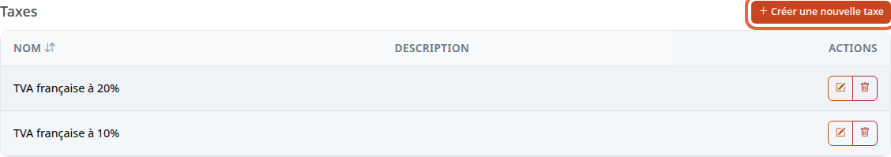
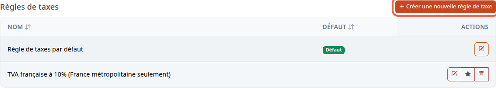
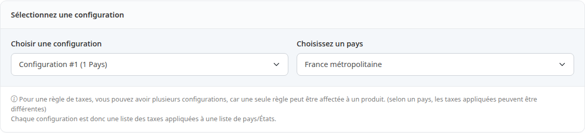
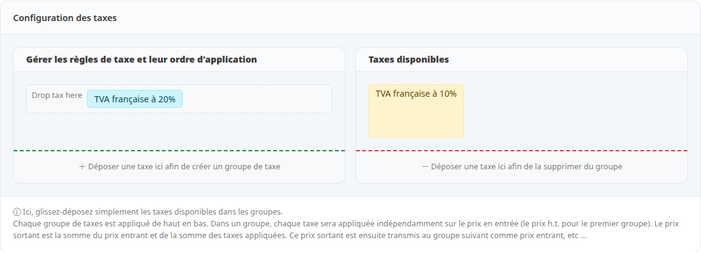
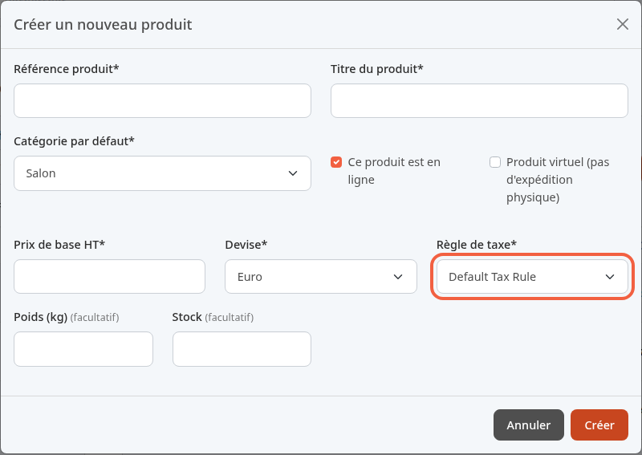
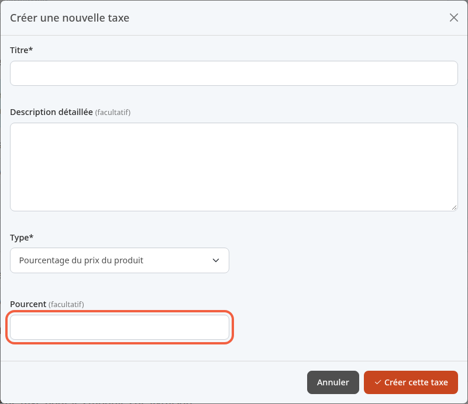

La TVA est la taxe qui s'ajoute au prix hors taxes (HT) d'un produit pour donner le prix toutes taxes comprises (TTC). Ce tutoriel explique comment Thelia la calcule et comment l'appliquer, par exemple 20 % à tous vos produits.

**Avant de commencer :** il vous faut un compte administrateur (voir [Découvrir le back-office](/getting-started/back-office-tour/)). La boutique de démonstration contient déjà des taxes et des règles : vous n'avez rien à créer pour appliquer 20 %.

## Taxe et règle de taxe

- **Une taxe** est un calcul. Exemple : **TVA française à 20%** ajoute 20 % du prix du produit.
- **Une règle de taxe** est un ensemble de taxes, pays par pays. Exemple : la règle dit que, pour la France, on applique la taxe à 20 %.
- **Un produit** est rattaché à une règle de taxe, jamais directement à une taxe.

Pour changer la TVA de vos produits, vous changez donc de règle, ou vous modifiez ce que contient la règle.

## Étape 1 : ouvrir les règles de taxes

1. Dans le menu de gauche, cliquez sur **Configuration**.
2. Dans le bloc **Catalogue produits**, cliquez sur **Règles de taxes**.

L'écran affiche deux phrases d'aide, puis deux listes.

La liste **Taxes** contient les calculs. Dans la démonstration, **TVA française à 20%** et **TVA française à 10%**.

La liste **Règles de taxes** contient les règles. Le badge **Défaut** repère la règle par défaut, ici **Règle de taxes par défaut**. L'icône en étoile d'une autre ligne permet de la définir comme règle par défaut.

## Étape 2 : voir ce que contient une règle

1. Dans la liste **Règles de taxes**, cliquez sur le crayon de la ligne **Règle de taxes par défaut**.
2. Cliquez sur l'onglet **Taxes**.
3. Dans **Choisissez un pays**, choisissez **France métropolitaine**.

Le choix du pays sélectionne la configuration qui le concerne : ici **Configuration #1 (1 Pays)**.

Plus bas, le bloc **Configuration des taxes** montre la taxe appliquée : **TVA française à 20%** est dans la colonne de gauche. **TVA française à 10%** est dans **Taxes disponibles**, donc non appliquée.

Si vous avez ouvert la règle pour la consulter, cliquez sur **Règles de taxes** dans le fil d'Ariane en haut pour quitter sans rien modifier.

## Étape 3 : rattacher la règle à un produit

Chaque produit porte une **Règle de taxe**. Elle se choisit à la création du produit.

1. Dans le menu de gauche, cliquez sur **Catalogue**.
2. Cliquez sur **Produits**.
3. Cliquez sur **Ajouter un nouveau produit** : la fenêtre **Créer un nouveau produit** s'ouvre.
4. Dans **Règle de taxe**, choisissez la règle à appliquer, par exemple **Default Tax Rule**.

Cette liste affiche les règles dans la langue par défaut de la boutique : dans la démonstration, l'anglais. **Default Tax Rule** y est donc la **Règle de taxes par défaut**.

Le prix saisi dans **Prix de base HT** est un prix hors taxes : la règle choisie sert à calculer le prix TTC. La création complète d'un produit est décrite dans le tutoriel du catalogue.

Pour changer la règle d'un produit existant, ouvrez-le, puis l'onglet **Combinaisons** : le champ **Règle de taxe** s'y trouve, avec le bouton **Enregistrer**. Ce champ n'apparaît que si le produit n'a pas de combinaison (tailles, couleurs). Sinon, l'écran ne permet pas de changer sa règle.

## Étape 4 : créer une taxe (si besoin)

Ne créez une taxe que si aucune taxe existante ne convient, par exemple pour un taux de 5,5 %.

1. Dans la liste **Taxes**, cliquez sur **Créer une nouvelle taxe**.
2. Dans **Titre**, saisissez par exemple `TVA à 5,5%`.
3. Dans **Type**, choisissez **Pourcentage du prix du produit**.
4. Dans **Pourcent**, saisissez le taux, par exemple `5.5`.
5. Cliquez sur **Créer cette taxe**.

La taxe n'est appliquée à aucun produit tant qu'elle n'est pas placée dans une règle.

## Étape 5 : placer une taxe dans une règle

1. Ouvrez la règle avec le crayon, puis l'onglet **Taxes**.
2. Dans **Choisissez un pays**, choisissez le pays concerné, par exemple **France métropolitaine**.
3. Glissez la taxe depuis **Taxes disponibles** vers **Gérer les règles de taxe et leur ordre d'application**. Déposée sur un groupe existant (zone **Drop tax here**), elle rejoint ce groupe. Déposée sur **Déposer une taxe ici afin de créer un groupe de taxe**, elle forme un nouveau groupe, placé en dessous.
4. Cliquez sur **Appliquer**.
5. Dans la fenêtre **Mettre à jour les taxes de la règle de taxe**, cliquez sur **Enregistrer la règle de taxes**.

Le choix du pays ne marche que pour un pays qui a déjà une configuration dans la règle : sinon, la configuration affichée ne change pas. Ce cas n'est pas traité ici. La modification vaut pour tous les pays de la configuration.

Les taxes d'un même groupe s'appliquent chacune sur le prix de départ. Les groupes s'appliquent de haut en bas, le prix obtenu par un groupe devenant le prix de départ du suivant.

Une seconde TVA placée dans la même règle ne remplace pas la première : les deux s'ajoutent. Pour un taux réduit, il faut une règle à part, comme **TVA française à 10% (France métropolitaine seulement)** dans la démonstration.

## Le résultat

Vos produits sont rattachés à une règle, et la règle contient la taxe à 20 % pour la France. Le prix TTC d'un produit est le prix HT augmenté de cette TVA.
